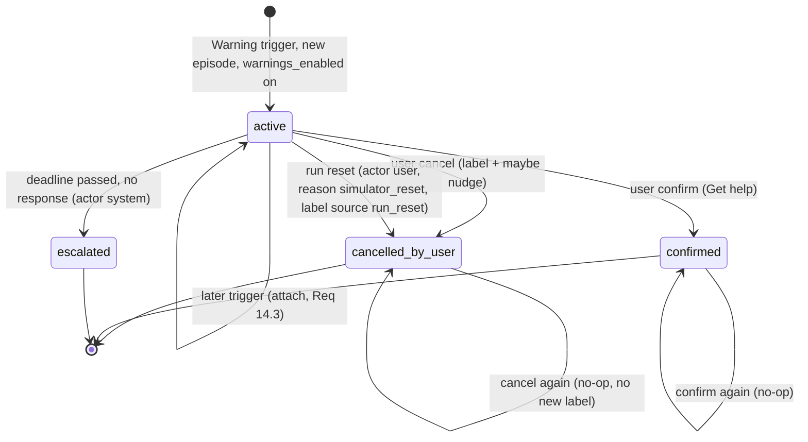

# Design Document: stroke-risk-ecg-motion

## Overview

This feature adds an experimental, non-diagnostic early-warning path for AF-related stroke-risk signals to HeartGuardian AI. A single-lead ECG rhythm model scores 10 s windows. A rule-based motion model gates ECG reliability and supplies corroborating signals (sudden collapse, prolonged inactivity). A pure fusion engine turns both streams into one of four states (Normal, Data_Quality, Watch, Warning). A warning lifecycle with a wall-clock countdown, cancel/confirm, and automatic simulated escalation runs inside the existing 5 s monitoring loop. Three data-grounded personas (`healthy`, `stroke_event`, `false_alarm`) replay committed real windows through that loop next to scenarios A/B/C.

The design splits into two worlds with one shared pure-numpy core:

- Offline pipeline (`backend/ml/`): downloads public datasets, preprocesses, splits, trains (scikit-learn + optional torch), evaluates, exports ONNX, builds persona packs and the demo DB snapshot. Runs once, overnight, under strict CPU limits.
- Backend runtime (`backend/app/`): loads the ONNX artifact with ONNX Runtime (never torch), plays persona packs, runs motion + fusion + warning logic, serves `/stroke/*`.
- Shared core (`backend/app/services/stroke/signal.py`, `motion.py`, `fusion.py`): numpy-only functions imported by both, so offline evaluation and runtime behavior cannot drift.

All user-facing text uses "possible acute event signs" or "AF-related rhythm signs", carries an experimental label, and never says "stroke detected".

### Key research findings that shape the design

- CinC 2017 has 8,528 single-lead records at 300 Hz, 9 to about 61 s long, labeled Normal/AF/Other/Noisy, with no patient IDs ([PhysioNet challenge-2017](https://physionet.org/content/challenge-2017/1.0.0/)). This drives D1/D2: one record = one patient = one modeling row.
- `wfdb.rdrecord(record, sampfrom, sampto, pn_dir=...)` and `wfdb.rdann(..., pn_dir=...)` stream only the requested sample range from PhysioNet ([wfdb io docs](https://wfdb.readthedocs.io/en/stable/io.html)). Full AFDB is roughly 23 records x ~27 MB, which breaks the 500 MB budget, so AFDB is read as slices only, after scanning the small `.atr` annotation files.
- UCI HAPT provides continuous 50 Hz waist-smartphone RawData with `labels.txt` (experiment, user, activity, start, end) covering 6 activities and 6 postural transitions; UCI HAR provides 2.56 s (128-sample) windows with subject IDs for the same 30 volunteers ([UCI HAPT](http://archive.ics.uci.edu/ml/datasets/Smartphone-Based), [UCI HAR](https://archive.ics.uci.edu/ml/datasets/human+activity+recognition+using+smartphones)). HAR is therefore evaluated on its native 2.56 s windows, and the motion model uses window-length-independent features.
- Current PyPI releases at design time (used as starting pins, see Dependencies): `wfdb 4.3.1`, `onnxruntime 1.31.0`, `onnx 1.23.2`, `skl2onnx 1.20.0`, `neurokit2 0.2.13`.

Content from these sources was rephrased for compliance with licensing restrictions.

### Existing-code facts the design relies on

- `monitoring.tick()` runs every 5 s (`INTERVAL_SECONDS = 5`) via `asyncio.to_thread`, under the module `RLock` `lock`, and only advances the simulator when `sim_state.status == "running"`. An exception inside `tick` pauses the simulator. Countdown checks must therefore run outside the running-only branch and be exception-isolated.
- `control("start")` on a fresh run calls `advance(INITIAL_STEPS)` (504 hourly ticks of history) and then `refresh()`. Each live tick appends one simulated hour.
- `SimulatorService.select_scenario` rejects anything outside A/B/C with `ValueError`; `ScenarioIn.scenario` is `Literal["A","B","C"]` (tests assert `"Z"` returns 422 and raises `ValueError`). `SimulatorService._tick_rng` looks up `{"A":1,"B":2,"C":3}[scenario]`, and `backfill_vo2()` runs at startup over every stored reading's scenario, so persona scenario values need their own RNG salts or startup crashes.
- `schema.sql` has no CHECK constraint on `measurements.scenario` or `sim_state.scenario`; `models.Scenario` is a typing-only `Literal`. Widening scenario values needs no migration.
- `EmergencyService.dispatch(decision, channel, confirmed, alert_id)` requires `confirmed=True`, rejects `channel="real"` unless `REAL_DISPATCH_ENABLED`, and records a `dispatch_events` row via the injected notifier. `evaluate()` returns `None` when `emergency_enabled` is off and raises `EmergencyNotAvailable` when no location or capable provider exists. `decision.payload` is a plain dict and can be extended before dispatch.
- All backend tests isolate the DB with `monkeypatch.setenv("HEARTGUARDIAN_DB", tmp)` plus `importlib.reload` of DB modules.
- `mobile/__tests__/history.test.tsx` replaces `@/api/hooks` with a mock that only defines `useMeasurements`, `useTrends`, `useAlertHistory`, and renders `HistoryScreen` without a `QueryClientProvider`.
- `mobile/app/emergency.tsx` already accepts a `findingSummary` route param.
- `.gitignore` ignores `*.db`, `lib/`, `downloads/`, `build/`, `*.manifest`, `*.log`, `.cache`. New paths must avoid those names.
- `conda` was not on PATH in the design-time PowerShell session. The implementer must locate it (`$env:CONDA_EXE`, `where.exe conda`, or the Anaconda Prompt init script) before any Python step, and stop and report if `hack1` cannot be found.

### Design decisions (DD)

Requirement-level decisions D1–D19 stay as written. The design adds these:

| ID | Decision | Rationale |
|---|---|---|
| DD1 | Runtime dependencies add only `onnxruntime`. R-peak detection, HRV, motion, and fusion are pure numpy. Persona packs are stored already filtered and resampled, so the runtime needs no scipy. | Smallest runtime footprint; no torch or scipy at runtime. |
| DD2 | Persona windows are precomputed and committed. The runtime still scores them live with ONNX Runtime each tick. Expected outputs are stored in the pack for replay tests. | Honest inference plus deterministic CI checks. |
| DD3 | Three clocks. Signal time (10 s per window) drives fusion and motion. The measurement clock (1 simulated hour per tick) labels windows: `ts = tick_hour + 10 s x slot`. Wall-clock drives the countdown. | Keeps existing hourly charts working and keeps countdown real-time. |
| DD4 | Fusion is a pure `step(state, window, params, threshold)`; its state is JSON-serialized into a single-row `stroke_state` table after each tick. | Determinism, restart safety, property testing. |
| DD5 | Display precedence: Warning > Watch > Data_Quality > Normal. | Watch is more informative than Data_Quality; Warning always wins. |
| DD6 | Warning episodes with re-arm. The fusion engine numbers Warning episodes; a new episode starts only after `WARNING_REARM_S` (60 s signal time) without a Warning trigger. The Warning_Service never creates a second event for an episode whose event is already resolved. | Prevents duplicate events after cancel or escalation. |
| DD7 | Escalation commits `status=escalated` first, then dispatches, then links the dispatch ID. Failures downgrade the channel to `in_app_only`. | At-most-once automatic dispatch; defines "escalation committed" for Req 15.7. |
| DD8 | Automatic dispatch calls the unchanged `EmergencyService` with an injected `SimulatedNotifier`, `channel="simulated"`, and `confirmed=True` supplied by the system. This is the D10 scoped exception. | No edits to the emergency module; the real gate stays untouched. |
| DD9 | A run reset (simulator reset or scenario switch) closes any `active` event as `cancelled_by_user`, actor `user`, reason `simulator_reset`. Its false-alarm label is stored with `source = 'run_reset'` and is excluded from nudge counting. The nudge counts `user_cancel` labels since the last reset. | Satisfies Req 17.1 literally and keeps demos repeatable (D16). |
| DD10 | One extra endpoint: `POST /stroke/warnings/{id}/acknowledge` persists the banner acknowledgement for escalated events. | Req 26.6 banner must survive reloads. |
| DD11 | Stroke tables live in a new `backend/app/db/stroke_schema.sql`, applied by `init_db` after `schema.sql`. A fifth table `stroke_state` holds runtime state. | Leaves the shared `schema.sql` untouched. |
| DD12 | `init_db(use_snapshot=True)` copies `demo_seed.db` only when `HEARTGUARDIAN_DB` is unset and the default DB file is missing. `reset_db()` calls `init_db(use_snapshot=False)`. | Tests always set the env var, so they are unaffected. |
| DD13 | Persona IDs have one source: `stroke_config.PERSONA_IDS`. `ScenarioIn` and `models.Scenario` Literals are widened; `"Z"` still fails. | Keeps A/B/C validation tests green. |
| DD14 | Healthy and False-alarm persona windows are selected at build time by the deployed model's score. The selection rule is recorded in pack provenance and disclosed in DEMO.md and EVALUATION.md. | Deterministic demo outcomes without hiding that selection happened. |
| DD15 | Subject split 19/4/4/3 (train/val/test/demo). Persona motion comes only from the 3 demo subjects; evaluation uses test subjects. | Persona data never overlaps evaluation data. |
| DD16 | The AFDB slice manifest is generated from annotations only and committed. Two persona slices from two different records are reserved before any training; the rest form the external set. | Disjointness (Req 4.3) and a fallback persona slice. |
| DD17 | NSTDB `em`/`ma` are split in time: first half for evaluation (SNR robustness, Episodes), second half for personas. NSTDB is never used in training. | No noise reuse between evaluation and demo. |
| DD18 | Processed `.npz` files are written by a deterministic zip writer (fixed timestamps, sorted keys); JSON is canonical (sorted keys). | Req 1.6 identical content hashes. |
| DD19 | `mobile/__tests__/history.test.tsx` gets two added mock entries (`useStrokeTimeline`, `useStrokeWarnings`). This is the only teammate test file touched; it is listed in TEAM.md. | The new History section needs hooks; the existing mock replaces the whole hooks module. |
| DD20 | `main.py` gets `stroke,` in the existing router import tuple plus one `app.include_router(stroke.router)` line, matching the existing "append ONE line" convention in that file. | Req 24.9 additive registration. |
| DD21 | A window is AF-positive iff `p > threshold`. Thresholds are chosen at midpoints between sorted unique validation scores. | No equality ambiguity between selection and runtime. |
| DD22 | `features_valid` means finite, non-flat signal with at least 3 R-peaks, for every model type. Invalid windows get `af_probability = NULL` and count toward Data_Quality. | Same Data_Quality semantics whether CNN or classical is deployed (Req 6.4, 12.7). |
| DD23 | Dependency pins are resolved at install time inside `hack1` and recorded exactly from `pip freeze`. The design lists starting pins. | Env Python and numpy versions were not verifiable at design time. |

## Architecture

### System view: offline pipeline vs backend runtime

```mermaid
flowchart LR
  subgraph SRC["Public sources (network, offline only)"]
    CINC["PhysioNet CinC 2017"]
    AFDB["PhysioNet AFDB (slices)"]
    NST["PhysioNet NSTDB em/ma"]
    HAR["UCI HAR"]
    HAPT["UCI HAPT RawData"]
  end

  subgraph OFF["Offline pipeline backend/ml (torch allowed, 2 threads, below-normal priority)"]
    ACQ["acquire.py + afdb_scan.py"] --> RAW[("backend/data/raw (gitignored)")]
    RAW --> PREP["prepare.py: filter, resample, window, split, provenance"]
    PREP --> PROC[("backend/data/processed (committed .npz + JSON)")]
    PROC --> TRAIN["train.py: classical + CNN-LSTM, CV, export"]
    TRAIN --> ART[("backend/models: stroke_model.onnx + stroke_model.json")]
    PROC --> EVAL["evaluate.py, motion_eval.py, fusion_eval.py, realism.py"]
    ART --> EVAL
    EVAL --> DOCS[("docs/EVALUATION.md, docs/figures, metrics.json")]
    PROC --> PERS["build_personas.py"]
    ART --> PERS
    PERS --> PACKS[("backend/data/processed/personas/*.npz + *.json")]
    PACKS --> SEED["build_demo_seed.py"]
    SEED --> SNAP[("backend/data/demo_seed.db")]
  end

  subgraph CORE["Shared numpy core backend/app/services/stroke"]
    SIG["signal.py"]
    MOT["motion.py"]
    FUS["fusion.py"]
  end

  subgraph RT["Backend runtime backend/app (no torch, no scipy)"]
    MON["monitoring.tick (5 s)"] --> PSIM["PersonaSimulator"]
    PSIM --> SRT["StrokeRuntime"]
    SRT --> INF["InferenceService (ONNX Runtime CPU)"]
    SRT --> WS["WarningService"]
    WS --> EMG["EmergencyService (existing, simulated channel)"]
    API["routers/stroke.py /stroke/*"] --> WS
    API --> DB[("SQLite heartguardian.db")]
    SRT --> DB
  end

  SRC --> ACQ
  CORE -. imported by .-> OFF
  CORE -. imported by .-> RT
  ART --> INF
  PACKS --> PSIM
  SNAP -. copied by init_db when DB missing .-> DB
  MOB["Expo app mobile/"] -->|HTTP JSON| API
```



The runtime never imports `backend/ml`. `backend/ml` imports `app.services.stroke.{signal,motion,fusion}` and `app.stroke_config`, so features, motion rules, and fusion logic are byte-identical in evaluation and in the demo.

### Per-tick runtime sequence

```mermaid
sequenceDiagram
  participant Loop as monitoring.run (5 s)
  participant Tick as monitoring.tick
  participant PS as PersonaSimulator
  participant RT as StrokeRuntime
  participant INF as InferenceService
  participant FU as fusion.step (pure)
  participant WS as WarningService
  participant EM as EmergencyService
  participant DB as SQLite

  Loop->>Tick: to_thread(tick)
  Tick->>Tick: with lock
  alt sim running and scenario is a persona
    Tick->>PS: advance()
    PS->>RT: process_tick(pack, next 3 window indices, tick_ts)
    RT->>INF: score(3 ECG windows)
    RT->>FU: step x3 (motion features + af_prob)
    RT->>DB: insert ml_windows, save stroke_state
    RT->>WS: on_output(warning_trigger, episode)
    WS->>DB: create or attach warning_events
    PS->>DB: insert hourly measurements (hr, hrv real-derived)
    Tick->>Tick: refresh() (existing analysis)
  else sim running and scenario is A/B/C
    Tick->>Tick: SimulatorService.advance(); refresh()
  end
  Tick->>WS: check_countdowns(now) (always, own try/except, under lock)
  WS->>DB: commit status=escalated
  WS->>EM: evaluate() + dispatch(channel=simulated, confirmed=True)
  WS->>DB: link dispatch_event_id or downgrade to in_app_only
```

### Backend file layout (exact paths)

New files are marked NEW. Edits to existing files are marked EDIT and kept minimal and additive.

```text
backend/
  requirements.txt                          EDIT  + onnxruntime==<pin>, + hypothesis==<pin> (test)
  requirements-ml.txt                       NEW   offline-only pins
  pyproject.toml                            EDIT  + onnxruntime dependency, + hypothesis in dev extras
  app/
    main.py                                 EDIT  `stroke,` in router import tuple + app.include_router(stroke.router)
    stroke_config.py                        NEW   Stroke_Config + validate()
    adapters/explainer.py                   NEW   ExplainerAdapter protocol + TemplateExplainer
    adapters/explainer_stubs.py             NEW   LocalLLMExplainer (interface-only stub)
    db/connection.py                        EDIT  snapshot bootstrap + apply stroke_schema.sql
    db/models.py                            EDIT  Scenario Literal widened (typing only)
    db/stroke_schema.sql                    NEW   ml_windows, warning_events, warning_feedback, threshold_adjustments, stroke_state
    db/stroke_models.py                     NEW   dataclasses for stroke rows
    db/stroke_repository.py                 NEW   SQL for stroke tables
    services/simulator.py                   EDIT  accept persona IDs, add persona RNG salts
    services/persona_simulator.py           NEW   PersonaSimulator(SimulatorService)
    services/monitoring.py                  EDIT  simulator dispatch by scenario, run-reset hook, countdown check
    services/stroke/__init__.py             NEW
    services/stroke/clock.py                NEW   Clock protocol, SystemClock, FakeClock
    services/stroke/signal.py               NEW   numpy R-peaks, RR, HRV features, z-score
    services/stroke/motion.py               NEW   motion features, activity state, MotionTracker
    services/stroke/fusion.py               NEW   FusionParams, FusionState, step(), run_sequence(), ecg_only_alerts()
    services/stroke/inference.py            NEW   InferenceService (ONNX Runtime or numpy LR)
    services/stroke/persona_pack.py         NEW   PersonaPack loader (WindowSource)
    services/stroke/warnings.py             NEW   WarningService
    services/stroke/runtime.py              NEW   StrokeRuntime orchestrator (process-wide singleton)
    routers/simulator.py                    EDIT  ScenarioIn Literal widened
    routers/stroke.py                       NEW   /stroke/* endpoints + Pydantic models
  ml/                                       NEW   offline only; run as `python -m ml.<module>` from backend/
    __init__.py
    resources.py        thread caps, below-normal priority, stage timer
    io_utils.py         deterministic npz writer, sha256, canonical JSON
    sources.py          URLs, mirrors, licenses, citations per dataset
    acquire.py          downloads with budget, timeout, fallbacks
    afdb_scan.py        builds ml/manifests/afdb_slices.json from .atr files
    preprocess.py       scipy bandpass + resample_poly (offline only)
    prepare.py          cohort selection, windowing, splits, provenance, manifests
    splits.py           pure split + disjointness logic (no torch)
    thresholds.py       pure threshold selection (no torch)
    flags.py            pure overfit / leakage / gap flag logic + test-run ledger
    models_classical.py LR + GB pipelines, skl2onnx export, numpy LR export
    models_cnn.py       CNN-LSTM (torch, imported lazily)
    train.py            CV, fit, select, export, ONNX parity
    evaluate.py         metrics, CIs, plots, EVALUATION.md sections
    motion_eval.py      motion per-class metrics, threshold calibration report
    fusion_eval.py      200 Episodes, ECG-only vs ECG+motion
    synth.py            NeuroKit2 filler + RR-irregular AF-like windows
    realism.py          KS tests, TSTR, persona provenance overlap check
    persona_specs.py    persona segment definitions
    build_personas.py   builds and verifies persona packs
    build_demo_seed.py  builds backend/data/demo_seed.db
    report.py           markdown helpers
    run_all.py          runs every stage in order with timings
    manifests/afdb_slices.json   committed slice manifest
  data/
    README.md                               NEW   Data_README
    raw/                                    NEW   Raw_Cache (gitignored)
    processed/                              NEW   Processed_Store (committed)
    demo_seed.db                            NEW   Demo_Seed_DB (committed via gitignore exception)
  models/
    stroke_model.onnx | stroke_model_lr.json  deployed artifact (one of)
    stroke_model.json                       metadata
    metrics.json                            all metrics + flags + stage durations
    test_runs.json                          test-evaluation ledger
  tests/                                    NEW test files listed in Testing Strategy
docs/
  MODEL_CARD.md, EVALUATION.md, PRIOR_ART.md (NEW); figures/*.png (NEW); DEMO.md (EDIT)
README.md, TEAM.md                          EDIT
```

Naming constraints from `.gitignore`: no directory named `lib`, `build`, `dist`, `downloads`, `var`, `parts`; no file ending `.manifest` or `.log` that must be committed.

### Mobile file layout

```text
mobile/
  api/types.ts                    EDIT  Stroke types; Scenario widened with PersonaId
  api/client.ts                   EDIT  8 stroke client functions
  api/hooks.ts                    EDIT  stroke query keys, queries, mutations
  utils/stroke.ts                 NEW   countdown math, labels, chip meta, snippet decimation
  components/StrokeWarningCard.tsx      NEW
  components/EscalationBanner.tsx       NEW
  components/PrivacyBadge.tsx           NEW
  components/EcgStrip.tsx               NEW   react-native-svg
  components/MotionTrace.tsx            NEW   react-native-svg
  components/AfProbabilityTimeline.tsx  NEW   react-native-svg
  components/WarningStatusChip.tsx      NEW
  components/WarningEventList.tsx       NEW
  components/StrokeHistorySection.tsx   NEW
  components/ScenarioPicker.tsx   EDIT  PERSONAS group, optional display label, scenarioTitle() helper
  app/warning/[id].tsx            NEW   Warning_Detail_Screen
  app/_layout.tsx                 EDIT  one Stack.Screen line for "warning/[id]"
  app/(tabs)/index.tsx            EDIT  EscalationBanner + StrokeWarningCard; scenario title via helper
  app/(tabs)/insights.tsx         EDIT  StrokeWarningCard
  app/(tabs)/history.tsx          EDIT  StrokeHistorySection
  app/(tabs)/simulator.tsx        EDIT  display name via helper; persona playback note
  __tests__/history.test.tsx      EDIT  two added mock entries (DD19)
  __tests__/stroke*.test.tsx|ts   NEW
```

## Components and Interfaces

### 1. Offline pipeline (`backend/ml/`)

All commands run from `backend/` as `conda run --no-capture-output -n hack1 python -m ml.<module>`. Every entry module imports `ml.resources` first.

#### 1.1 Resource controls (`ml/resources.py`) — Req 33

```python
# Must run before numpy/torch import.
for var in ("OMP_NUM_THREADS", "MKL_NUM_THREADS", "OPENBLAS_NUM_THREADS", "NUMEXPR_NUM_THREADS"):
    os.environ.setdefault(var, "2")

def lower_priority() -> None:
    if os.name == "nt":
        import ctypes
        BELOW_NORMAL_PRIORITY_CLASS = 0x00004000
        h = ctypes.windll.kernel32.GetCurrentProcess()
        ctypes.windll.kernel32.SetPriorityClass(h, BELOW_NORMAL_PRIORITY_CLASS)
    else:
        os.nice(10)

def limit_torch(torch) -> None:
    torch.set_num_threads(cfg.TORCH_THREADS)       # 2
    torch.set_num_interop_threads(1)

@contextmanager
def stage(name: str, log: dict):                     # wall-clock per stage -> metrics.json "stageDurationsS"
    t0 = time.perf_counter(); yield; log[name] = round(time.perf_counter() - t0, 2)
```

No `psutil` dependency. The ctypes call is Windows-native; failure to lower priority is logged as a warning and never stops the run.

#### 1.2 Acquisition (`ml/sources.py`, `ml/acquire.py`) — Req 1, 33.4

| Dataset | Primary source | Fallback 1 | Fallback 2 | Expected size |
|---|---|---|---|---|
| CinC 2017 | `https://physionet.org/files/challenge-2017/1.0.0/training2017.zip` + `.../REFERENCE-v3.csv` | wfdb `pn_dir="challenge-2017/1.0.0/training"` streaming of only the selected + Demo_Pool records (labels read first) | Configured zip mirror `CINC2017_ZIP_MIRROR` (default the PhysioNet project zip), only if its `Content-Length` fits the remaining budget | ~100 MB |
| AFDB slices | wfdb `rdrecord(rec, sampfrom, sampto, channels=[0], pn_dir="afdb/1.0.0")`, `rdann(rec, "atr", pn_dir=...)` | Direct `{rec}.hea/.atr` + HTTP Range request on `{rec}.dat` (format 212, 3 bytes per 2-channel frame) | Whole-record `.dat` download in manifest priority order while budget allows; skipped slices are recorded | ~6 MB |
| NSTDB | wfdb `pn_dir="nstdb/1.0.0"`, records `em`, `ma` | Direct files `https://physionet.org/files/nstdb/1.0.0/{em,ma}.{hea,dat}` | D5: IMU-derived artifact (see 1.4) with `source_used = "imu_derived_fallback"` | ~4 MB |
| UCI HAR | `https://archive.ics.uci.edu/static/public/240/human+activity+recognition+using+smartphones.zip` | `https://archive.ics.uci.edu/ml/machine-learning-databases/00240/UCI%20HAR%20Dataset.zip` | none, error | ~60 MB |
| UCI HAPT | `https://archive.ics.uci.edu/static/public/341/smartphone+based+recognition+of+human+activities+and+postural+transitions.zip` | `https://archive.ics.uci.edu/ml/machine-learning-databases/00341/HAPT%20Data%20Set.zip` | none, error | ~80 MB |

Rules:

- `DownloadBudget(max_mb=500)`: before each download, a HEAD request reads `Content-Length`; a download that would exceed the remaining budget is refused and the next fallback is tried. Streamed bytes are counted; the measured total goes to `data_manifest.json` (`totalDownloadMb`).
- Every request uses `timeout=cfg.DOWNLOAD_TIMEOUT_S` and `cfg.DOWNLOAD_RETRIES` retries with backoff 2 s, 4 s. Timeout or HTTP error on a PhysioNet primary moves to the next fallback (Req 1.4). The source actually used is stored per dataset as `sourceUsed`.
- Files stream to `<name>.part` and are renamed on completion. Zips are verified with `zipfile.ZipFile.testzip()`. A sha256 of every raw file is recorded.
- Raw files go to `backend/data/raw/<dataset>/`. If a raw file already exists with a matching recorded sha256, it is reused (no network).
- After acquisition, `require_files()` checks a per-dataset list of required paths (for example `REFERENCE-v3.csv`, `RawData/labels.txt`, `UCI HAR Dataset/train/subject_train.txt`) and raises `MissingRawFileError("<dataset>: <path>")` (Req 1.5).

#### 1.3 AFDB slice manifest (`ml/afdb_scan.py`, `ml/manifests/afdb_slices.json`) — Req 1.1, 1.2, DD16

`afdb_scan.py` runs only if the manifest is absent (or with `--rebuild`). It reads only the `.atr` annotation files (a few KB each) for the 23 AFDB records with signals (`04015 04043 04048 04126 04746 04908 04936 05091 05121 05261 06426 06453 06995 07162 07859 07879 07910 08215 08219 08378 08405 08434 08455`). Rhythm changes come from `aux_note` values (`(AFIB`, `(N`, `(AFL`, `(J`).

Candidate onset rule: an `(AFIB` annotation at sample `s` with at least `AFDB_MIN_PRE_NONAF_S` (120 s) of continuous non-AF before it and at least 600 s of continuous AF after it. Slice = `[s - 300 s, s + 600 s]` (15 min at 250 Hz), clipped to rhythm boundaries. At most one slice per record. Selection is seeded:

1. Rank candidates by pre-onset non-AF duration (descending), then record ID. The top 2 from two different records become `role: "persona"` (primary + backup).
2. Up to `AFDB_MAX_EXTERNAL_SLICES` (12) of the remaining records, seeded sample, become `role: "external"`.

```json
{
  "schema": "afdb_slices/v1",
  "database": "afdb/1.0.0",
  "fs": 250,
  "channel": 0,
  "seed": 42,
  "selectionRule": "AF onset with >=120 s non-AF before and >=600 s AF after; slice = onset-300 s .. onset+600 s",
  "slices": [
    {"sliceId": "afdb-08378-1", "record": "08378", "role": "persona", "rank": 1,
     "sampfrom": 1234500, "sampto": 1459500, "onsetSample": 1309500,
     "preNonAfS": 412.0, "postAfS": 900.0},
    {"sliceId": "afdb-04015-1", "record": "04015", "role": "external", "...": "..."}
  ]
}
```

The values in the example are placeholders; real values come from the scan. The manifest is committed and is the only input the downloader uses for AFDB (Req 1.2).

#### 1.4 Preprocessing and windowing (`ml/preprocess.py`, `ml/prepare.py`) — Req 2, 3, 4, 5

ECG (every source):

1. Native-rate zero-phase Butterworth bandpass, order 4, 0.5–40 Hz: `scipy.signal.sosfiltfilt(butter(4, [0.5, 40], btype="band", fs=fs, output="sos"), x)`.
2. Resample to 125 Hz with `scipy.signal.resample_poly`: 300 Hz → up 5 / down 12; 250 Hz → up 1 / down 2; 360 Hz → up 25 / down 72.
3. Non-overlapping 10 s windows of exactly 1250 samples. Windows with any non-finite value are dropped.
4. Stored in mV as `int16` with scale 0.001 mV per count (range ±32.7 mV). Model input normalization (z-score) happens in `app.services.stroke.signal.zscore`, shared by training and runtime.

CinC 2017 cohort (Req 2):

- Labels from `REFERENCE-v3.csv`. Pool = records labeled `N` or `A` with duration ≥ 10 s.
- Seeded sample (`np.random.default_rng(SeedSequence([SEED, 2017]))`) of exactly 700 `N` and 300 `A`. One row per record: window starting at sample 0 of the filtered, resampled record.
- Demo_Pool: seeded sample of `DEMO_POOL_NORMAL` (150) `N` and `DEMO_POOL_AF` (40) `A` records from the remaining pool. All full windows of Demo_Pool records are kept.
- Splits: `StratifiedShuffleSplit` twice on the record level: 700 train (490 N / 210 AF), 150 val (105 / 45), 150 test (105 / 45). Every full window of each test record is also stored (`cinc2017_test_windows.npz`) for Episodes and SNR robustness. Grouping unit = record ID (D1).

AFDB: slices processed with the ECG pipeline; each window labeled AF if more than 50% of its samples fall inside an `(AFIB` rhythm interval, else non-AF; the onset offset within the slice (in windows and seconds) is recorded (Req 3.6).

NSTDB: `em` and `ma` channel 0, bandpassed and resampled to 125 Hz. Split in time: first half `eval`, second half `persona` (DD17). IMU fallback (D5): if NSTDB is unavailable, noise = z-scored, 0.5–40 Hz bandpassed acceleration magnitude from HAPT walking-upstairs/downstairs streams of demo and test subjects, resampled from 50 Hz to 125 Hz.

UCI HAPT (Req 3.4, 3.5):

- RawData `acc_expXX_userYY.txt` (g) and `gyro_expXX_userYY.txt` (rad/s) at 50 Hz.
- Tiled windows: non-overlapping 500-sample windows per experiment. Label = the `labels.txt` activity covering the majority of samples; `unlabeled` if no activity covers a majority (excluded from evaluation).
- Transition-centered windows: one 500-sample window centered on each labeled postural transition segment. Its `label` is still the majority label (usually the end posture); `transition` holds the transition name (for example `stand_to_lie`) and `transitionCoverage` its sample fraction.
- Stored as `int16`, acc scale 0.001 g, gyro scale 0.001 rad/s.

UCI HAR: `total_acc_{x,y,z}` 128-sample windows (g) for val, test, and demo subjects only, with subject IDs and labels. Train-subject HAR windows are not stored (not needed).

Subject split (Req 4.2, DD15): the 30 subject IDs are shuffled with the seed and assigned 19 train, 4 val, 4 test, 3 demo. The same assignment applies to HAR and HAPT.

Activity label mapping used everywhere:

| HAPT/HAR label | Motion_Model state |
|---|---|
| WALKING, WALKING_UPSTAIRS, WALKING_DOWNSTAIRS | dynamic |
| SITTING, STANDING | static |
| LAYING | lying |
| 6 postural transitions | excluded from per-class metrics; kept as `transition` metadata |

Provenance (Req 5.1) is stored per window inside each `.npz` as parallel arrays (`dataset`, `record_id` or `subject_id`, `experiment_id`, `sample_offset` in original samples, `fs_original`) plus a dataset-level `meta_json` entry holding license, citation, version, and `isSynthetic`. `prepare.py` fails if any window lacks provenance.

#### 1.5 Split manifest and disjointness (`ml/splits.py`) — Req 4.3, 4.5, 9.7

```json
{
  "schema": "split_manifest/v1",
  "seed": 42,
  "cinc2017": {"train": ["A00001"], "val": [], "test": [], "demoPool": []},
  "subjects": {"train": [1, 3], "val": [], "test": [], "demo": []},
  "afdb": {"external": ["04015"], "persona": ["08378", "05091"]}
}
```

`check_disjoint(manifest) -> list[str]` namespaces IDs (`cinc:A00001`, `subject:7`, `afdb:04015`) and returns every ID that appears in more than one set across all partitions, the AFDB external set, the AFDB persona set, and the Demo_Pool. `prepare.py` writes the manifest only if the list is empty. `train.py` re-runs the check first and raises `LeakageError("overlapping IDs: ...")` before any training (Req 9.7).

#### 1.6 Classical baseline (`app/services/stroke/signal.py`, `ml/models_classical.py`) — Req 6

Features per window (computed by the runtime module `signal.hrv_features`): `rmssd_ms`, `sdnn_ms`, `pnn50_pct`, `mean_hr_bpm`, `rr_irregularity`. Order is fixed as `FEATURE_ORDER`.

Two scikit-learn pipelines, both fit on train only (Req 6.3):

- `Pipeline([SimpleImputer(strategy="median"), StandardScaler(), LogisticRegression(class_weight="balanced", max_iter=2000, C=c)])`, `C ∈ {0.1, 1, 10}`.
- `Pipeline([SimpleImputer(strategy="median"), GradientBoostingClassifier(n_estimators=n, max_depth=d, learning_rate=0.05, subsample=0.8, random_state=SEED)])`, `n ∈ {100, 200}`, `d ∈ {2, 3}`.

Windows with invalid features (fewer than 3 R-peaks, DD22) are excluded from classical training and scored as data-quality cases in evaluation (reported as a separate count, not as AF or non-AF).

Export: `skl2onnx.convert_sklearn(pipe, initial_types=[("features", FloatTensorType([None, 5]))], options={id(pipe.steps[-1][1]): {"zipmap": False}}, target_opset=17)`; output `probabilities[:, 1]`. If skl2onnx fails, the LR pipeline is exported as `stroke_model_lr.json` (imputer medians, scaler mean/scale, coefficients, intercept) and scored with numpy (`model_type = "classical_lr_numpy"`).

#### 1.7 CNN-LSTM (`ml/models_cnn.py`) — Req 7

Input `[batch, 1, 1250]` z-scored ECG. Output `[batch, 1]` AF_Probability (sigmoid inside the graph).

| Layer | Shape out | Params |
|---|---|---|
| Conv1d(1→16, k7, p3) + BN + ReLU + MaxPool(2) | 16 x 625 | 160 |
| Conv1d(16→32, k7, p3) + BN + ReLU + MaxPool(2) | 32 x 312 | 3,680 |
| Conv1d(32→64, k5, p2) + BN + ReLU + MaxPool(2) | 64 x 156 | 10,432 |
| Conv1d(64→64, k5, p2) + BN + ReLU + MaxPool(2) | 64 x 78 | 20,672 |
| Dropout(p) | 64 x 78 | 0 |
| LSTM(64→64, 1 layer, batch_first), mean over time | 64 | 33,280 |
| Dropout(p) + Linear(64→1) + Sigmoid | 1 | 65 |
| Total | | ≈ 68.3k (cap 200k, asserted) |

Training (Req 7.3–7.6):

- Augmentation on train windows only, each applied with probability 0.5 per sample: amplitude scale U(0.8, 1.2); baseline wander `A·sin(2π f t + φ)`, `A ∈ U(0, 0.1)` (z-units), `f ∈ U(0.05, 0.5)` Hz; Gaussian noise σ ∈ U(0, 0.05); circular time shift U(−125, 125) samples. Augmentation RNG is a seeded `torch.Generator`.
- `AdamW(lr=1e-3, weight_decay=1e-4)`, dropout `p ∈ {0.3, 0.5}` (the only CNN hyperparameter tuned), `BCELoss` with per-sample weights `w_c = N / (2·N_c)` (inverse class frequency), batch 32.
- Epoch cap `EPOCH_CAP` (40); early stopping on validation loss with `EARLY_STOP_PATIENCE` (6). The state dict with the lowest validation loss is kept in memory and restored before export.
- During 5-fold CV the inner fold's held-out part plays the validation role; the outer validation partition is used only for final threshold, model selection, and early stopping of the final fit.
- `torch.manual_seed(SEED)`, `torch.use_deterministic_algorithms(True, warn_only=True)`.

Export: `torch.onnx.export(model.eval(), dummy, path, input_names=["ecg"], output_names=["af_prob"], dynamic_axes={"ecg": {0: "batch"}, "af_prob": {0: "batch"}}, opset_version=17)`.

#### 1.8 Training runner, selection, export (`ml/train.py`) — Req 4.4, 8.1, 8.8, 10.1, 10.2, 33.5

1. Check split disjointness (1.5).
2. Grouped stratified 5-fold CV (`StratifiedGroupKFold(n_splits=5, shuffle=True, random_state=SEED)`, groups = record IDs) inside train for every hyperparameter candidate; best candidate per family by mean CV AUPRC.
3. Refit each family's best candidate on full train (CNN: early stopping on the validation partition).
4. Threshold per model on validation (`ml/thresholds.py`, Req 8.1, 8.2):
   - candidates = midpoints between consecutive sorted unique validation scores, plus 0.0 and 1.0;
   - choose the highest candidate `t` with `sensitivity(p > t) ≥ 0.90`;
   - if none qualifies, choose the `t` with maximum sensitivity (ties → highest `t`) and record `sensitivityShortfall`.
5. Deployed model = higher validation AUPRC among {best classical, CNN} (D15, Req 8.8). Ties → classical (simpler).
6. Export ONNX + `stroke_model.json`. Parity check on the first 100 test windows (inputs only, no labels): `max|onnx − native| ≤ 1e-4` or the export fails (Req 10.2).
7. torch failure handling (Req 33.5): any exception from `import torch`, training, or ONNX export of the CNN marks `fallback = {"used": true, "reason": "<exception class: message>"}`; the classical winner is deployed. The fallback is written into metadata and the Model_Card generator.

Model version string: `v1-<modelType>-<dataManifestSha256[:8]>-s<seed>`.

#### 1.9 Evaluation harness (`ml/evaluate.py`, `ml/flags.py`) — Req 8.3–8.7, 9

- Metrics for CV (mean ± sd over folds), validation, test, AFDB external: AUROC, AUPRC, F1, sensitivity, specificity, confusion matrix at the selected threshold.
- Reliability diagram (10 equal-width bins) and Brier score on validation and test.
- Learning curves: stratified subsamples of train at fractions 0.10, 0.25, 0.50, 0.75, 1.00 (seeded); train and validation AUROC per fraction per model.
- 95% bootstrap CIs (1000 resamples, percentile method, resampling records) for test AUROC, sensitivity, specificity.
- Test-once ledger `backend/models/test_runs.json`: `{modelVersion: {"testedAt": iso, "overrides": [...]}}`. A second test evaluation for the same version raises `TestAlreadyEvaluatedError` unless `--override-test-rerun "<reason>"` is passed; each override is appended to the ledger and printed into EVALUATION.md (Req 8.3, 8.4).
- Flags (Req 9.1–9.4), pure functions in `ml/flags.py`:
  - `overfit_suspect = any(m == 1.0 for m in val/test/external metrics among AUROC, AUPRC, F1, sensitivity, specificity)`;
  - `leakage_suspect = not (0.40 <= shuffle_val_auroc <= 0.60)` per model, where the shuffle model is retrained on permuted train labels (seeded permutation);
  - `generalization_gap = train_auroc - val_auroc > 0.10`.
  - Any set flag is printed as a warning block at the top of EVALUATION.md.
- External validation (Req 9.5): deployed model on AFDB external windows, table next to test metrics.
- SNR robustness (Req 9.6): each test window gets NSTDB `eval`-half noise (seeded choice of `em` or `ma` and offset), scaled so `10·log10(P_ecg / P_noise) = SNR` with power computed on the window; SNR ∈ {24, 12, 6, 0} dB; AUROC, sensitivity, specificity per level.
- Motion evaluation (`ml/motion_eval.py`, Req 11.6): per-class precision, recall, F1 of `{dynamic, static, lying}` on test-subject HAPT tiled windows and test-subject HAR windows; plus a threshold-calibration table on train subjects showing each motion threshold's effect (no automatic config rewrite; chosen values are copied into `stroke_config.py` by hand with a comment citing EVALUATION.md).
- Figures (matplotlib `Agg`, 100 dpi PNG) into `docs/figures/`. All metrics and flags into `backend/models/metrics.json`.

#### 1.10 Fusion evaluator (`ml/fusion_eval.py`) — Req 13

Builds 200 Episodes of 60 windows (10 min) with `SeedSequence([SEED, 13])`:

| Type | Count | ECG | Motion |
|---|---|---|---|
| `af_collapse` | 40 | AFDB external slice: onset placed at window 24 ± U{−6..6}; pre-onset non-AF, post-onset AF | test-subject static/dynamic mix before onset; a `stand_to_lie` or `sit_to_lie` transition-centered window 0–12 windows after onset, then lying windows |
| `af_activity` | 40 | same as above | test-subject walking / standing / sitting mix, no lying transition |
| `normal_rest` | 60 | test-partition CinC Normal windows (all windows of test records) and AFDB external non-AF windows | test-subject sitting/standing/lying; 20 of 60 include a lie-down transition |
| `normal_vigorous` | 60 | test-partition CinC Normal windows + NSTDB `eval` noise at SNR U{0, 3, 6} dB | test-subject walking-upstairs/downstairs/walking windows |

Windows are sampled with replacement within each pool; reuse counts are reported as a limitation.

Configurations:

- ECG-only: `fusion.ecg_only_alerts(probs, threshold, params)`: K-of-N over all windows, `None` probabilities count as not above, no motion input, same re-arm rule.
- ECG+motion: `fusion.run_sequence(...)`, reporting Watch entries and Warning entries separately.

Metrics per configuration: False_Alarms_Per_Day (alerts in `normal_*` Episodes ÷ their total hours × 24), Episode-level sensitivity (AF Episodes with an alert at or after onset), median time-to-alert from onset (s). Tables: Watch-level (ECG-only alert vs ECG+motion Watch) and Warning-level (ECG-only alert vs ECG+motion Warning, labeled "depends on how Episodes were constructed"). 95% bootstrap CIs over Episodes (1000 resamples, stratified by type). Time-to-alert ECDF plot to `docs/figures/fusion_time_to_alert.png`.

#### 1.11 Synthetic filler and realism validator (`ml/synth.py`, `ml/realism.py`) — Req 22

Fitting (train partition only):

- From train Normal records: per-record mean HR and within-record HR std (from `signal.hrv_features` RR intervals). Fit `μ_HR`, `σ_between` (std of record means), `σ_within` (median within-record std).
- From train AF records: pooled RR mean and RR std.

Normal filler: per 60 s segment draw `hr ~ N(μ_HR, σ_between)` clipped to [45, 110]; `nk.ecg_simulate(duration=60, sampling_rate=250, heart_rate=hr, heart_rate_std=σ_within, method="ecgsyn", random_state=seed_i)`; drop the first 5 s; run the standard ECG pipeline (bandpass, 250 → 125 Hz); cut 10 s windows.

AF-like (RR-irregular) windows for TSTR: extract one median beat template from a NeuroKit2 `method="simple"` sinus signal at 250 Hz; draw RR intervals i.i.d. from a Gamma distribution with the train AF RR mean and std (method of moments), clipped to [300, 1600] ms; overlap-add the template at cumulative RR times; same pipeline. No fibrillatory waves are modeled (Known Limitation).

Every synthetic window carries provenance `dataset = "synthetic:neurokit2"`, `isSynthetic = true`, and the fitted parameters (`hr`, `hrStd`, `rrMeanMs`, `rrStdMs`, `method`, `randomState`).

Realism checks:

- `scipy.stats.ks_2samp` for `mean_hr_bpm`, `rmssd_ms`, `rr_irregularity`: real test Normal vs synthetic Normal, and real test AF vs synthetic AF-like. Statistic, p-value, overlay histogram per metric. `p < 0.05` → "distribution differs" (Req 22.3, 22.4).
- TSTR: LR classical pipeline trained on 700 synthetic Normal + 300 synthetic AF-like, tested on the real test partition; AUROC reported next to the train-on-real classical AUROC (Req 22.5).
- Overlap check: every persona window's `cinc:` record ID is checked against train, val, and test; any hit raises `PersonaLeakageError` listing the IDs (Req 22.6).

#### 1.12 Persona builder (`ml/persona_specs.py`, `ml/build_personas.py`) — Req 18–21, DD14

Each persona is a list of segments. Each segment names an ECG source pool, a motion source pool, a window count, and optional noise. The builder fills segments deterministically (`SeedSequence([SEED, persona_salt, segment_index])`), scores ECG windows with the exported ONNX model (onnxruntime offline), runs `fusion.run_sequence`, and asserts the persona's acceptance gates. If a gate fails, it tries the next seeded candidate (up to 200 attempts per segment), then raises `PersonaBuildError` with the gate name.

Healthy (`healthy`, 120 windows = 40 ticks ≈ 200 s, `endBehavior: "loop"`):

| Segment | Windows | ECG | Motion |
|---|---|---|---|
| H1 walk | 12 | Demo_Pool Normal | demo-subject WALKING |
| H2 desk | 48 | Demo_Pool Normal | demo-subject SITTING/STANDING |
| H3 filler | 12 | `synthetic:neurokit2` Normal filler | demo-subject SITTING |
| H4 rest | 36 | Demo_Pool Normal | `sit_to_lie` transition-centered + LAYING (low energy) |
| H5 up | 12 | Demo_Pool Normal | `lie_to_stand` transition-centered + STANDING |

Selection rule: only Demo_Pool Normal windows with model score ≤ `threshold − 0.05`. Gate: zero Warning triggers over two full loops (Req 19.2). H4 shows that prolonged inactivity alone does not warn.

Stroke-event (`stroke_event`, 54 windows = 18 ticks = 90 s, `endBehavior: "hold"`), from the primary AFDB persona slice (backup slice if gates fail):

| Segment | Windows | ECG | Motion |
|---|---|---|---|
| S1 pre-onset | 18 (3 min) | AFDB non-AF, same record, ending at the onset | 6 demo-subject WALKING, then 12 SITTING/STANDING |
| S2 onset | 6 | AFDB AF from onset | demo-subject STANDING |
| S3 lie-down | 12 | AFDB AF continuing | 1 `stand_to_lie` transition-centered window, then 11 LAYING windows with energy < `INACTIVITY_ENERGY_G2` |
| S4 still | 18 | AFDB AF continuing | LAYING low-energy |

Gates (Req 20.1–20.4): ≥ 120 s non-AF before onset from the same record; fusion states visit Normal → Watch → Warning in order; first Warning trigger at window index `w` with `(floor(w / 3) + 1) × 5 s ≤ 120 s`. Expected first Warning ≈ window 31, tick 11, about 55 s after start; escalation about 30 s later. Every S3/S4 motion window carries the note: "Motion is a controlled lie-down from a lab dataset (UCI HAPT), not a real fall or stroke."

False-alarm (`false_alarm`, 66 windows = 22 ticks = 110 s, `endBehavior: "hold"`):

| Segment | Windows | ECG | Motion |
|---|---|---|---|
| F1 stairs | 24 | Demo_Pool Normal + NSTDB `persona`-half noise at SNR ∈ {6, 3, 0, −3} dB | demo-subject WALKING_UPSTAIRS / WALKING_DOWNSTAIRS (label "vigorous movement (stair walking)") |
| F2 cool-down | 6 | Demo_Pool Normal, clean | demo-subject STANDING |
| F3 noisy rest | 36 | Demo_Pool Normal + NSTDB `persona`-half noise at SNR ∈ {18, 12, 9, 6} dB | SITTING, then `sit_to_lie` transition-centered, then LAYING low-energy |

Gates: F1 all windows unreliable with downgrade reason, zero Warnings (Req 21.2); F1 replayed through `ecg_only_alerts` gives ≥ 1 alert (Req 21.3), so F1 windows are chosen among noisy windows the model scores above threshold; F3 raises a Warning (Req 21.4), so its first K-of-N windows are noisy Normal windows the model scores above threshold (genuine model false positives under low noise, recorded as `selection: "model_false_positive_under_noise"`). F2 lets Data_Quality clear between segments.

Pack output: `personas/<id>.npz` and `personas/<id>.json` (format in Data Models). The builder also runs `realism.check_persona_overlap` (Req 22.6).

#### 1.13 Demo seed builder (`ml/build_demo_seed.py`) — Req 30

1. `HEARTGUARDIAN_DB = backend/data/demo_seed.build.db` (deleted first); `init_db(use_snapshot=False)`; `seed_providers()`; synthetic care profile identical to `seed_data.py` ("Demo User", `+1-555-0001`, contact "Jordan (demo contact)" `+1-555-0002`, demo-center location).
2. Install a `FakeClock` starting at `2026-01-01T09:00:00Z`.
3. Run `false_alarm`: select, start, call the tick function until a Warning is active, cancel it as the user, run to the end of the pack.
4. Temporarily set `emergency_enabled = 1`; run `stroke_event` until active; advance the clock by `COUNTDOWN_S + 1`; run `check_countdowns()` → `escalated` / `simulated_dispatch` with a `dispatch_events` row; set `emergency_enabled = 0` again (opt-in default restored).
5. Select scenario `A` (run reset: measurements and `ml_windows` cleared, threshold reset logged), status `paused`, cursor `NULL`.
6. `PRAGMA journal_mode=DELETE; VACUUM;` then copy to `backend/data/demo_seed.db`, delete the build file.

The snapshot therefore contains the full current schema, providers, the synthetic profile, two past warning events with snippets, one simulated dispatch, feedback, and adjustment logs. No measurements, so the dashboard shows its normal empty state.

#### 1.14 Dependencies — Req 33.1, DD23

`backend/requirements-ml.txt` (offline only). Starting pins; the implementer installs, then rewrites the file from `pip freeze` with the exact resolved versions:

```text
# Offline ML pipeline only. Runtime never imports these.
# torch CPU build: install with
#   conda run --no-capture-output -n hack1 python -m pip install torch==<pin> --index-url https://download.pytorch.org/whl/cpu
torch==<latest CPU wheel for the env's Python, resolved at install>
wfdb==4.3.1
scipy==<resolved>
neurokit2==0.2.13
onnx==1.23.2
skl2onnx==1.20.0
onnxruntime==1.31.0
matplotlib==<resolved>
requests==<resolved>
```

`backend/requirements.txt` additions: `onnxruntime==<same pin>` (runtime) and `hypothesis==<resolved>` (tests, next to the existing pytest/httpx lines). No scipy at runtime (DD1). `pyproject.toml` gets `onnxruntime` in `dependencies` and `hypothesis` in `dev`.

Install order: (1) verify interpreter, (2) `pip install -r requirements.txt`, (3) torch CPU from the CPU index, (4) remaining ML pins. If torch install fails, continue without it (classical fallback). If pip reports a conflict with the env's existing numpy or scikit-learn, pick the newest release of the conflicting ML package that installs without changing numpy/scikit-learn, and record the result.

### 2. Backend runtime (`backend/app/`)

#### 2.1 Stroke_Config (`app/stroke_config.py`) — Req 12.1, 12.2

One flat module of UPPER_CASE constants, each with an inline comment, plus `_RANGES` and `validate()`. Selected values can be overridden by environment variables (applied before validation): `HG_STROKE_COUNTDOWN_S`, `HG_STROKE_MODEL_DIR`, `HG_STROKE_PERSONA_DIR`. `validate()` runs at import; `routers/stroke.py` imports this module, so `app.main` import (backend startup) fails fast.

```python
class StrokeConfigError(ValueError):
    """Raised at startup when a Stroke_Config parameter is outside its documented range."""

def validate(values: dict | None = None) -> None:
    values = values or {k: v for k, v in globals().items() if k.isupper()}
    for name, (lo, hi) in _RANGES.items():
        v = values[name]
        if not (lo <= v <= hi):
            raise StrokeConfigError(f"{name}={v!r} outside valid range [{lo}, {hi}]")
    if values["K_OF_N_K"] > values["K_OF_N_N"]:
        raise StrokeConfigError("K_OF_N_K must be <= K_OF_N_N")
    if values["WATCH_LOOKBACK_S"] < values["K_OF_N_N"] * values["WINDOW_S"]:
        raise StrokeConfigError("WATCH_LOOKBACK_S must cover K_OF_N_N windows")
```

| Group | Parameter | Default | Valid range | Purpose |
|---|---|---|---|---|
| general | `SEED` | 42 | [0, 2^31−1] | every seeded step |
| general | `PERSONA_IDS` | `("healthy","stroke_event","false_alarm")` | fixed | single source of persona scenario IDs |
| signal | `ECG_FS_HZ` / `WINDOW_S` / `ECG_WINDOW_SAMPLES` | 125 / 10 / 1250 | fixed | window spec |
| signal | `MOTION_FS_HZ` / `MOTION_WINDOW_SAMPLES` | 50 / 500 | fixed | motion window spec |
| signal | `BANDPASS_LOW_HZ` / `BANDPASS_HIGH_HZ` / `BANDPASS_ORDER` | 0.5 / 40.0 / 4 | fixed / fixed / [2, 8] | Req 3.1 |
| signal | `RR_MIN_MS` / `RR_MAX_MS` | 250 / 2000 | [200, 400] / [1500, 3000] | plausible RR range |
| signal | `MIN_R_PEAKS` | 3 | [3, 5] | Req 6.4 |
| data | `COHORT_NORMAL` / `COHORT_AF` | 700 / 300 | fixed | Req 2.2 |
| data | `DEMO_POOL_NORMAL` / `DEMO_POOL_AF` | 150 / 40 | [50, 1000] / [0, 300] | Demo_Pool size |
| data | `SPLIT_FRACTIONS` | (0.70, 0.15, 0.15) | fixed | Req 4.1 |
| data | `SUBJECT_SPLIT` | (19, 4, 4, 3) | sum = 30 | train/val/test/demo subjects |
| data | `AFDB_MIN_PRE_NONAF_S` | 120 | [120, 600] | Req 20.1 |
| data | `AFDB_MAX_EXTERNAL_SLICES` / `AFDB_PERSONA_SLICES` | 12 / 2 | [4, 21] / [1, 2] | slice manifest |
| data | `DOWNLOAD_TIMEOUT_S` / `DOWNLOAD_RETRIES` | 120 / 2 | [10, 900] / [0, 5] | Req 1.4 |
| data | `MAX_TOTAL_DOWNLOAD_MB` | 500 | [50, 500] | Req 33.4 |
| data | `CINC2017_ZIP_MIRROR` | PhysioNet project zip URL | non-empty | Req 1.4 |
| train | `TORCH_THREADS` | 2 | [1, 2] | Req 33.2 |
| train | `EPOCH_CAP` / `EARLY_STOP_PATIENCE` | 40 / 6 | [5, 100] / [2, 20] | Req 7.5 |
| train | `BATCH_SIZE` / `LEARNING_RATE` / `WEIGHT_DECAY` | 32 / 1e-3 / 1e-4 | [8, 128] / [1e-5, 1e-2] / [0, 1e-2] | CNN |
| train | `CV_FOLDS` / `TARGET_SENSITIVITY` | 5 / 0.90 | fixed | Req 4.4, 8.1 |
| train | `MAX_CNN_PARAMS` | 200000 | fixed | Req 7.2 |
| eval | `BOOTSTRAP_RESAMPLES` | 1000 | [200, 5000] | CIs |
| eval | `SNR_LEVELS_DB` | (24, 12, 6, 0) | fixed | Req 9.6 |
| eval | `SHUFFLE_AUROC_RANGE` / `GENERALIZATION_GAP` | (0.40, 0.60) / 0.10 | fixed | Req 9.3, 9.4 |
| eval | `ONNX_PARITY_TOL` / `ONNX_PARITY_WINDOWS` | 1e-4 / 100 | fixed | Req 10.2 |
| eval | `EPISODES` / `EPISODE_WINDOWS` | {af_collapse 40, af_activity 40, normal_rest 60, normal_vigorous 60} / 60 | fixed | Req 13.1, 13.2 |
| fusion | `K_OF_N_K` / `K_OF_N_N` | 3 / 5 | [1, N] / [1, 20] | Req 12.4, D8 |
| fusion | `WATCH_LOOKBACK_S` | 300 | [N·10, 1800] | max age of a reliable window in the K-of-N set |
| fusion | `COINCIDENCE_INTERVAL_S` | 300 | [10, 1800] | Req 12.6, D8 |
| fusion | `DATA_QUALITY_FRACTION` | 0.5 | fixed | Req 12.7 |
| fusion | `WARNING_REARM_S` | 60 | [10, 1800] | DD6 |
| motion | `VERTICAL_AXIS` | 0 | [0, 2] | HAPT/HAR phone x-axis is vertical when upright |
| motion | `DYNAMIC_ENERGY_G2` | 0.01 | [1e-4, 0.5] | energy above → dynamic |
| motion | `LYING_ANGLE_DEG` | 60 | [30, 85] | posture above → lying |
| motion | `ARTIFACT_MAG_VAR_G2` / `ARTIFACT_JERK_RMS_GPS` | 0.02 / 4.0 | [1e-4, 1] / [0.1, 50] | Req 11.3 |
| motion | `INACTIVITY_ENERGY_G2` | 0.002 | [1e-5, 0.05] | Req 11.4 |
| motion | `PROLONGED_INACTIVITY_S` | 60 | [20, 600] | Req 11.4, D8 |
| motion | `IMPACT_PEAK_G` / `COLLAPSE_GAP_S` | 2.5 / 10 | [1.2, 8] / [10, 60] | Req 11.5 |
| warning | `COUNTDOWN_S` | 30 | [10, 120] | Req 14.1, D8 |
| warning | `CONTEXT_S` | 30 | [10, 60] | Req 14.2 snippet length |
| warning | `NUDGE_STEP` / `NUDGE_START_COUNT` / `NUDGE_CAP` | 0.01 / 3 / 0.05 | (0, 0.05] / [1, 20] / [0, 0.05] | Req 17.2, 17.3 |
| warning | `ML_WINDOWS_RETENTION` | 5000 | [500, 50000] | per-run row cap for `ml_windows` |
| persona | `WINDOWS_PER_TICK` | 3 | [1, 6] | Req 18.3, D12 |
| persona | `PERSONA_BACKFILL_HOURS` | 504 | [24, 672]; a test asserts it equals `monitoring.INITIAL_STEPS` (no import cycle) | backfill length |
| paths | `MODEL_DIR` / `PERSONA_DIR` | `backend/models` / `backend/data/processed/personas` | existing dir not required | artifact locations |

Motion defaults are initial values from typical waist-IMU magnitudes; `motion_eval.py` reports their effect on train subjects, and any change is made by hand in this file with a comment citing EVALUATION.md.

#### 2.2 Signal core (`app/services/stroke/signal.py`) — Req 6.1, 6.4

Pure numpy, no scipy.

```python
FEATURE_ORDER = ("rmssd_ms", "sdnn_ms", "pnn50_pct", "mean_hr_bpm", "rr_irregularity")

@dataclass(frozen=True)
class HrvFeatures:
    rmssd_ms: float; sdnn_ms: float; pnn50_pct: float; mean_hr_bpm: float
    rr_irregularity: float; n_beats: int; rr_ms: tuple[float, ...]
    def as_vector(self) -> np.ndarray: ...

def zscore(x: np.ndarray) -> np.ndarray            # (x - mean) / max(std, 1e-6)
def window_quality_ok(x: np.ndarray) -> bool       # finite and std > 1e-3 mV
def detect_r_peaks(x: np.ndarray, fs: int = 125) -> np.ndarray
def rr_intervals_ms(peaks: np.ndarray, fs: int = 125) -> np.ndarray
def hrv_features(x: np.ndarray, fs: int = 125) -> HrvFeatures | None
```

R-peak detection (simplified Pan-Tompkins, deterministic):

1. Return empty if `not window_quality_ok(x)`.
2. `d = np.gradient(x)`; `e = d**2`; moving-window integration `m = np.convolve(e, np.ones(w)/w, mode="same")`, `w = round(0.15·fs)`.
3. `thr = 0.25 · percentile(m, 99)`. Contiguous runs where `m > thr` are QRS candidates.
4. In each run (extended by ±0.05 s), the R location is `argmax |x − median(x)|` (polarity-agnostic; CinC has inverted leads).
5. Refractory 0.25 s: of two peaks closer than that, keep the larger `|x − median(x)|`.

Features: RR from consecutive peaks, keep `RR_MIN_MS ≤ RR ≤ RR_MAX_MS`. If fewer than `MIN_R_PEAKS` peaks or fewer than 2 valid RR → `None` (data-quality case). Otherwise:

- `mean_hr_bpm = 60000 / mean(RR)`
- `sdnn_ms = std(RR, ddof=1)`
- `rmssd_ms = sqrt(mean(diff(RR)^2))`
- `pnn50_pct = 100 · mean(|diff(RR)| > 50)`
- `rr_irregularity = median(|diff(RR)|) / median(RR)` (normalized median absolute successive difference; robust to single ectopic beats)

`evaluate.py` reports agreement with `neurokit2.ecg_peaks` on test windows as a sanity check (offline only).

#### 2.3 Motion_Model (`app/services/stroke/motion.py`) — Req 11.1–11.5

```python
ActivityState = Literal["dynamic", "static", "lying"]
CorroborationKind = Literal["collapse", "prolonged_inactivity"]

@dataclass(frozen=True)
class MotionFeatures:
    mag_mean_g: float; mag_var_g2: float; energy_g2: float; posture_deg: float
    jerk_rms_gps: float; peak_g: float; activity_state: ActivityState; artifact: bool

def motion_features(acc_g: np.ndarray, fs: int = 50, p: MotionParams = DEFAULT) -> MotionFeatures

@dataclass(frozen=True)
class MotionTrackerState:
    prev_state: ActivityState | None = None
    bout_active: bool = False
    inactive_s: float = 0.0
    last_impact_t: float | None = None

def track(s: MotionTrackerState, f: MotionFeatures, t: float, p: MotionParams
          ) -> tuple[MotionTrackerState, CorroborationKind | None]
```

Features on any window length (500 samples for HAPT, 128 for HAR):

- `mag = ||acc||₂` per sample; `mag_mean_g`, `mag_var_g2 = var(mag)`, `peak_g = max(mag)`.
- `energy_g2 = mean_over_axes(var(acc_axis))`.
- `posture_deg = degrees(arccos(clip(|ḡ_v| / ||ḡ||, 0, 1)))` with `ḡ = mean(acc)` and `v = VERTICAL_AXIS`; ≈ 0° upright, ≈ 90° lying.
- `jerk_rms_gps = sqrt(mean((diff(mag)·fs)^2))`.

Classification (exactly one state, Req 11.2): `dynamic` if `energy > DYNAMIC_ENERGY_G2`; else `lying` if `posture_deg > LYING_ANGLE_DEG`; else `static`.

Artifact flag (Req 11.3): `mag_var > ARTIFACT_MAG_VAR_G2 or jerk_rms > ARTIFACT_JERK_RMS_GPS`.

Tracker (signal time `t = window_index × 10 s`):

- Transition to lying: `prev_state != "lying"` (including `None`) and current `lying` → `bout_active = True`, `inactive_s = 0`.
- While `bout_active`, a window with state in {lying, static}, `energy < INACTIVITY_ENERGY_G2`, and no artifact adds `WINDOW_S` to `inactive_s`; any other window ends the bout (`bout_active = False`). The transition window itself counts if it qualifies.
- `inactive_s ≥ PROLONGED_INACTIVITY_S` → emit `prolonged_inactivity` on that window and on every later window of the same bout (Req 11.4).
- Impact: `peak_g > IMPACT_PEAK_G` sets `last_impact_t = t`. A later window with `0 < t − last_impact_t ≤ COLLAPSE_GAP_S` and state in {lying, static} emits `collapse` and clears `last_impact_t` (Req 11.5). If both signals apply, `collapse` is reported.

#### 2.4 Fusion_Engine (`app/services/stroke/fusion.py`) — Req 12.3–12.10

```python
FusionStateName = Literal["normal", "data_quality", "watch", "warning"]

@dataclass(frozen=True)
class FusionParams:          # built from stroke_config; tests generate random valid instances
    k: int; n: int; window_s: float; watch_lookback_s: float
    coincidence_s: float; dq_fraction: float; rearm_s: float; motion: MotionParams

@dataclass(frozen=True)
class WindowInput:
    index: int                      # stream index within the run (monotonic)
    af_prob: float | None           # None => features invalid or not scored
    motion: MotionFeatures

@dataclass(frozen=True)
class FusionState:
    recent: tuple[tuple[int, bool], ...] = ()          # (index, reliable) for last n windows
    reliable: tuple[tuple[int, float], ...] = ()       # (index, af_prob) for last n reliable windows
    motion: MotionTrackerState = MotionTrackerState()
    last_watch_t: float | None = None
    last_corr_t: float | None = None
    last_corr_kind: str | None = None
    episode_id: int = 0
    in_episode: bool = False
    clear_s: float = 0.0
    def to_json(self) -> str: ...
    @staticmethod
    def from_json(s: str) -> "FusionState": ...

@dataclass(frozen=True)
class FusionOutput:
    index: int; state: FusionStateName; reliable: bool; af_prob: float | None
    watch: bool; watch_count: int; kofn_indices: tuple[int, ...]
    corroboration: str | None; warning_trigger: bool; episode_id: int
    downgrade_reason: str | None; motion: MotionFeatures

def step(s: FusionState, w: WindowInput, p: FusionParams, threshold: float) -> tuple[FusionState, FusionOutput]
def run_sequence(windows: Iterable[WindowInput], p: FusionParams, threshold: float,
                 state: FusionState = FusionState()) -> tuple[FusionState, list[FusionOutput]]
def ecg_only_alerts(probs: Sequence[float | None], p: FusionParams, threshold: float) -> list[int]
```

`step` algorithm (`t = w.index × window_s`):

1. `reliable = (not w.motion.artifact) and (w.af_prob is not None)` (Req 12.3).
2. `recent ← (recent + (index, reliable))[-n:]`; if reliable, `reliable ← (reliable + (index, af_prob))[-n:]`; drop reliable entries older than `watch_lookback_s`.
3. `above = [i for i, q in reliable if q > threshold]`; `watch = len(above) ≥ k` (Req 12.4).
4. `motion, corr = motion.track(...)`; if `corr`: `last_corr_t = t`. If `watch`: `last_watch_t = t`.
5. `warning = (watch and last_corr_t is not None and t − last_corr_t ≤ coincidence_s) or (corr is not None and last_watch_t is not None and t − last_watch_t ≤ coincidence_s)` (Req 12.6).
6. Episodes (DD6): on `warning`, if not `in_episode`: `episode_id += 1`, `in_episode = True`; `clear_s = 0`. Otherwise `clear_s += window_s`, and `in_episode = False` once `clear_s ≥ rearm_s`. `warning_trigger = warning`.
7. `dq = count(not r for _, r in recent) > dq_fraction × len(recent)` (Req 12.7).
8. State by precedence (DD5): `warning` → `"warning"`; `watch` → `"watch"`; `dq` → `"data_quality"`; else `"normal"`. A Watch without corroboration is reported as `"watch"` with no countdown (Req 12.5).
9. `downgrade_reason`: `"motion_artifact_excluded"` if artifact; else `"invalid_features"` if `af_prob is None`; else `"watch_without_corroboration"` if state is `"watch"`; else `None` (Req 12.8, 21.2).

No wall clock, randomness, or I/O inside `step`, so identical inputs give identical outputs (Req 12.9). Since `reliable` does not depend on the threshold, raising the threshold can only shrink `above` (Req 12.10).

`ecg_only_alerts`: K-of-N over all windows (no reliability gate, `None` counts as below), alert index = first window of each alert episode under the same re-arm rule.

#### 2.5 InferenceService (`app/services/stroke/inference.py`) — Req 10.3, 10.4

```python
class InferenceService:
    def __init__(self, model_dir: Path = cfg.MODEL_DIR) -> None: ...
    available: bool
    unavailable_reason: str | None      # "missing_artifact" | "load_failed: <msg>" | "onnxruntime_missing"
    meta: ModelMeta | None              # parsed stroke_model.json
    def score(self, ecg_mv: np.ndarray) -> list[float | None]   # ecg_mv: [n, 1250] float32
```

- Loads `stroke_model.json`, then either `onnxruntime.InferenceSession(<artifact>, sess_options, providers=["CPUExecutionProvider"])` with `intra_op_num_threads = 1`, `inter_op_num_threads = 1`, or the numpy LR JSON. `onnxruntime` is imported inside `__init__`, so a missing package makes the feature unavailable instead of breaking app import.
- Per window: if `signal.hrv_features(x)` is `None` → `None` (DD22). Otherwise `raw_ecg` models get `zscore(x)` shaped `[n, 1, 1250]`; `hrv_features` models get the 5-feature vector. Output clipped to [0, 1].
- Any exception during load sets `available = False` with a reason. The runtime then skips window scoring and reports the feature as unavailable; monitoring, measurements, alerts, and emergency flows keep working.
- The module never imports torch; a test asserts `"torch" not in sys.modules` after importing `app.main` in a subprocess.

#### 2.6 PersonaPack (`app/services/stroke/persona_pack.py`)

```python
@dataclass(frozen=True)
class WindowData:
    pack_index: int; ecg_mv: np.ndarray; acc_g: np.ndarray
    provenance: dict; is_synthetic: bool; segment: str; note: str | None

class PersonaPack:
    persona_id: str; n_windows: int; end_behavior: Literal["loop", "hold"]
    backfill_hr: np.ndarray; backfill_hrv: np.ndarray        # 504 hourly values, synthetic filler
    expected: dict                                          # expected outputs for replay tests
    @classmethod
    def load(cls, persona_id: str, persona_dir: Path = cfg.PERSONA_DIR) -> "PersonaPack": ...
    def pack_index(self, stream_index: int) -> int | None    # loop: i % n; hold: i if i < n else None
    def window(self, stream_index: int) -> WindowData | None
```

Loaded lazily and cached per process (`functools.lru_cache(maxsize=3)` keyed by persona ID and file mtime). A missing or corrupt pack raises `PersonaPackError`, which the simulator turns into HTTP 409 on scenario selection.

#### 2.7 WarningService (`app/services/stroke/warnings.py`) — Req 14–17

```python
class WarningConflict(Exception): ...     # -> HTTP 409
class WarningNotFound(Exception): ...     # -> HTTP 404

class WarningService:
    def __init__(self, clock: Clock, explainer: ExplainerAdapter, emergency_factory=...): ...
    def on_output(self, out: FusionOutput, ctx: TriggerContext) -> int | None   # returns warning id if created/attached
    def cancel(self, warning_id: int) -> CancelResult            # actor "user"
    def confirm(self, warning_id: int) -> ConfirmResult          # actor "user"
    def acknowledge(self, warning_id: int) -> WarningEvent
    def check_countdowns(self) -> list[int]                      # escalated ids
    def on_run_reset(self, reason: str = "simulator_reset") -> None
    def personal_threshold(self, base: float) -> float
```

All mutating calls run under `monitoring.lock` (router handlers and the tick both take it), so cancel/confirm and escalation are serialized.

Lifecycle:



Rejected transitions return HTTP 409 and leave the row unchanged: cancel on `confirmed`/`escalated`; confirm on `cancelled_by_user`/`escalated` (Req 15.3, 15.6). Cancel/confirm check the current status, not the deadline, so a request that wins the lock before the escalation commit is applied (Req 15.7).

`on_output` rules:

1. Ignore if `not out.warning_trigger`.
2. If `user_settings.warnings_enabled` is off: return `None` (fusion rows are still stored, Req 14.4).
3. If an `active` event exists: attach (increment `attached_trigger_count`, append window row IDs, max 50), return its ID (Req 14.3).
4. If an event already exists for `(run_id, episode_id)`: return `None` (DD6).
5. Else create (Req 14.1, 14.2): `status = active`, `created_at = clock.now()`, `countdown_deadline = created_at + COUNTDOWN_S`, explanation from the explainer, evidence JSON, provenance of the K-of-N windows and the context windows, ECG snippet = pack windows `[index − 2 .. index]` concatenated (30 s at 125 Hz, `CONTEXT_S`), motion snippet = acceleration magnitude for the same windows (30 s at 50 Hz), persona note, status history `[{from: null, to: "active", actor: "system", at, reason: "warning_trigger"}]`.

Cancel (Req 15.1, 15.2, 17.1–17.5):

1. `cancelled_by_user` already → return unchanged, `falseAlarmRecorded = false`.
2. `active` → status `cancelled_by_user`, `cancelled_at = resolved_at = now`, history entry (actor `user`).
3. Insert `warning_feedback(label="false_alarm", source="user_cancel")`; the UNIQUE `warning_event_id` makes a second insert impossible.
4. `n = count(user_cancel labels created after the latest run_reset row in threshold_adjustments)`. If `n ≥ NUDGE_START_COUNT`: `new = round(min(old + NUDGE_STEP, NUDGE_CAP), 6)`; if `new != old`, update `stroke_state.threshold_offset` and insert a `threshold_adjustments` row (old, new, `false_alarm_nudge`, warning ID, timestamp).

Confirm (Req 15.4, 15.5): `active` → `confirmed`, history entry; returns `findingSummary` for `router.push("/emergency", {findingSummary})`. `confirmed` again → unchanged. Confirm does not dispatch; the existing emergency screen keeps its own confirm dialog and real-dispatch gate.

`check_countdowns` (Req 16, DD7, DD8), for each `active` event with `countdown_deadline ≤ now`:

1. Read `emergency_enabled`.
2. Commit `status = escalated`, `escalation_channel = "simulated_dispatch" if enabled else "in_app_only"`, `resolved_at = now`, history entry (actor `system`, reason `auto_escalation_no_response`). This commit is the "escalation committed" point.
3. If disabled: done, no dispatch (Req 16.5).
4. If enabled:
   ```python
   svc = EmergencyService(notifier=SimulatedNotifier())          # always simulated (Req 16.3)
   decision = svc.evaluate(finding_summary=summary)              # profile default location
   if decision is None: raise EmergencyNotAvailable("Emergency response is not enabled.")
   decision.payload.update({"trigger": "auto_escalation_no_response",
                            "warningEventId": event.id,
                            "routingReason": decision.routing_reason})
   dispatch = svc.dispatch(decision, channel="simulated", confirmed=True)   # D10 scoped exception
   ```
   On success store `dispatch_event_id` (Req 16.4). On `EmergencyNotAvailable` (or any exception) set `escalation_channel = "in_app_only"` and `escalation_failure = str(e)` (Req 16.6).
5. `summary` comes from `explainer.explain(..., purpose="dispatch_summary")` and always contains "possible acute event signs" (Req 16.7). `EmergencyService` and `emergency_config.REAL_DISPATCH_ENABLED` are not modified (Req 16.8).

`on_run_reset` (Req 17.6, DD9): close any `active` event as described in DD9; set `threshold_offset = 0`; insert `threshold_adjustments(old, 0, "run_reset", NULL, now)` (logged even when old is already 0, so the reset point is always recorded).

`personal_threshold(base) = base + stroke_state.threshold_offset`, which stays in `[base, base + 0.05]` (Req 17.4).

#### 2.8 StrokeRuntime (`app/services/stroke/runtime.py`)

Process-wide singleton `get_runtime()` that wires `InferenceService`, `WarningService`, `TemplateExplainer`, `SystemClock`, and `FusionParams.from_config()`. Tests call `reset_runtime(clock=FakeClock(...), model_dir=..., persona_dir=...)`.

```python
@dataclass
class TickResult:
    hr_bpm: float | None; hrv_ms: float | None; rhythm_flag: float | None
    real_valid_windows: int; quality: Literal["ok", "low", "missing"]
    outputs: list[FusionOutput]

class StrokeRuntime:
    def process_tick(self, pack: PersonaPack, tick_ts: datetime, scenario: str) -> TickResult
    def check_countdowns(self) -> list[int]
    def on_run_reset(self, scenario: str) -> None
    def status(self) -> StrokeStatus
```

`process_tick`:

1. Load `stroke_state` (run ID, window cursor, fusion JSON, offset).
2. Get up to `WINDOWS_PER_TICK` windows from `pack.window(cursor + j)`; `hold` packs return fewer or none at the end.
3. Hourly HR/HRV from `signal.hrv_features` of the real (non-synthetic) windows: prefer reliable ones (`quality = "ok"`), else any valid real ones (`quality = "low"`), else none (`quality = "missing"`, value `None`). RR intervals are pooled within windows only. If the tick has only filler windows or none, HR/HRV come from `pack.backfill_*` cycled by hour with `is_synthetic = 1`.
4. If inference is available: score, build `WindowInput`s, run `fusion.step` per window with `threshold = personal_threshold(meta.threshold)`, insert one `ml_windows` row per window (Req 12.8) with `ts = tick_ts + 10 s × slot`, then call `WarningService.on_output`. `rhythm_flag = 1.0` if any reliable real window has `af_prob > threshold`, else `0.0`.
5. Save `stroke_state` (cursor, fusion JSON). Prune `ml_windows` beyond `ML_WINDOWS_RETENTION` for the run.

Exceptions in steps 3–5 are logged, set a degraded flag (`unavailable_reason = "runtime_error: <msg>"`), and return a `TickResult` with `outputs = []`, so the simulator keeps writing measurements.

#### 2.9 PersonaSimulator and simulator/monitoring edits — Req 18

`app/services/persona_simulator.py`:

```python
class PersonaSimulator(SimulatorService):
    def advance(self, steps: int = 1) -> SimState: ...
```

- Same cursor and anchor logic as `SimulatorService.advance` (fresh run anchors at `_EPOCH_ANCHOR`, so timestamps are deterministic).
- `steps > 1` (fresh start with `INITIAL_STEPS = 504`): writes backfill hours only, no window processing. `hr`/`hrv` from `pack.backfill_*` (synthetic filler, `is_synthetic = 1`); `spo2`, `activity`, `sleep`, `rhythm`, and daily `vo2max` from the inherited baseline generator with the persona RNG salt (`is_synthetic = 1`). Records `stroke_state.run_started_at = clock.now()`.
- `steps == 1` (live tick): `StrokeRuntime.process_tick(...)`; `hr`, `hrv` (and `rhythm` when inference is available) from real windows with `is_synthetic = 0` (Req 18.6); the other metrics synthetic with `is_synthetic = 1`. Rows are tagged `scenario = <persona id>`.

`app/services/simulator.py` (EDIT, two small changes):

```python
from ..stroke_config import PERSONA_IDS
ALL_SCENARIOS = ("A", "B", "C", *PERSONA_IDS)
# select_scenario: `if scenario not in ALL_SCENARIOS: raise ValueError(...)`
# _tick_rng: scenario_salt = {"A": 1, "B": 2, "C": 3, "healthy": 11, "stroke_event": 12, "false_alarm": 13}[scenario]
```

A/B/C code paths and salts are unchanged. A golden-hash test recorded before the edit guards Req 18.7.

`app/services/monitoring.py` (EDIT):

```python
def _simulator_for(scenario: str) -> SimulatorService:
    from .persona_simulator import PersonaSimulator
    return PersonaSimulator() if scenario in PERSONA_IDS else SimulatorService()

# control(): sim = _simulator_for(state.scenario); after sim.reset() -> _stroke_reset(state.scenario)
# select_scenario(): after sim.reset(); sim.select_scenario(s) -> _stroke_reset(s); then start via control() as today

def tick():
    with lock:
        state = repo.get_sim_state()
        if state.status == "running":
            _simulator_for(state.scenario).advance()
            refresh()
    _check_countdowns()          # every loop iteration, running or paused (Req 16.1, D13)

def _check_countdowns() -> None:
    try:
        with lock:
            get_runtime().check_countdowns()
    except Exception:
        logging.getLogger(__name__).exception("Stroke countdown check failed; simulator unaffected")
```

`_stroke_reset(scenario)` calls `get_runtime().on_run_reset(scenario)`: new `run_id = f"{scenario}:{run_seq}"` (`run_seq` increments in `stroke_state`), cursor 0, empty `FusionState`, delete current-run `ml_windows`, then `WarningService.on_run_reset()`. Warning history, feedback, adjustments, and dispatches are kept (mirrors "prior alerts remain in history").

`app/routers/simulator.py` (EDIT): `scenario: Literal["A", "B", "C", "healthy", "stroke_event", "false_alarm"]`. `SimStateOut.scenario` is already `str`. `PersonaPackError` on selection → HTTP 409 with the pack path.

#### 2.10 Explainer adapters (`app/adapters/explainer.py`, `app/adapters/explainer_stubs.py`) — Req 23

```python
@dataclass(frozen=True)
class ExplanationContext:
    fusion_state: str; k_count: int; n: int
    af_prob_min: float | None; af_prob_max: float | None; threshold: float
    reliable_count: int; total_count: int
    motion_signal: str | None; countdown_s: int | None
    purpose: Literal["status", "warning", "dispatch_summary"] = "status"

@dataclass(frozen=True)
class Explanation:
    title: str; body: str; summary: str; experimental_label: str

class ExplainerAdapter(Protocol):
    name: str
    def is_available(self) -> bool: ...
    def explain(self, ctx: ExplanationContext) -> Explanation: ...

class TemplateExplainer:            # active implementation
    name = "template"
    def is_available(self) -> bool: return True
    def explain(self, ctx: ExplanationContext) -> Explanation: ...
```

Templates (all end with the experimental label "Experimental prototype, not a diagnosis. AF_Probability is a model output, not a clinically validated score."):

| State | Title | Body pattern |
|---|---|---|
| normal | "No rhythm signs flagged" | "Recent reliable ECG windows were below your threshold ({thr:.2f})." |
| data_quality | "ECG reliability reduced" | "{u} of the last {n} windows were set aside, likely because of movement or signal quality." |
| watch | "AF-related rhythm signs, review" | "{k} of the last {n} reliable 10-second ECG windows had model outputs {lo:.2f}–{hi:.2f}, above your threshold {thr:.2f}. No movement pattern of concern was seen." |
| warning | "Possible acute event signs" | "AF-related rhythm signs ({k} of {n} reliable windows, model output {lo:.2f}–{hi:.2f}) occurred together with {motion_phrase}. If you are OK, cancel the warning. Otherwise help is requested in {countdown_s} s." |
| dispatch_summary | — | "Experimental: possible acute event signs. AF-related rhythm signs in {k} of {n} reliable windows with {motion_phrase}; no response within {countdown_s} s. Not a diagnosis." |

`motion_phrase`: `collapse` → "a sudden impact followed by stillness"; `prolonged_inactivity` → "prolonged stillness after lying down".

`app/adapters/explainer_stubs.py` follows `sensor_stubs.py`:

```python
_FUTURE_MSG = "future adapter — not implemented in MVP"

class LocalLLMExplainer:
    """Interface-only placeholder for a future on-device / local LLM explainer (privacy). No weights downloaded."""
    name = "local_llm"
    def is_available(self) -> bool:
        return False
    def explain(self, ctx: ExplanationContext) -> Explanation:
        raise NotImplementedError(f"LocalLLMExplainer.explain: {_FUTURE_MSG}")
```

### 3. Stroke_API (`app/routers/stroke.py`) — Req 24

`router = APIRouter(prefix="/stroke", tags=["stroke"])`. Registered in `main.py` per DD20. JSON fields are camelCase and every response carries `isExperimental: true` (Req 24.8). Mutations take `monitoring.lock`. No authentication, same as every existing route (D17); README flags this as local-only.

| Method | Path | Success | Errors |
|---|---|---|---|
| GET | `/stroke/status` | `StrokeStatusOut` | — |
| GET | `/stroke/warnings?limit=50` | `WarningListOut` (newest first) | 422 if `limit` ∉ [1, 200] |
| GET | `/stroke/warnings/{id}` | `WarningDetailOut` | 404 |
| POST | `/stroke/warnings/{id}/cancel` | `WarningActionOut` | 404, 409 |
| POST | `/stroke/warnings/{id}/confirm` | `WarningActionOut` | 404, 409 |
| POST | `/stroke/warnings/{id}/acknowledge` | `WarningActionOut` (DD10) | 404, 409 if not `escalated` |
| GET | `/stroke/timeline?from=&to=&limit=360` | `TimelineOut` | 422 if `limit` ∉ [1, 2000] |
| GET | `/stroke/model` | `ModelInfoOut` | — (`available: false` when missing) |

```python
FusionStateName = Literal["normal", "data_quality", "watch", "warning"]
WarningStatus = Literal["active", "cancelled_by_user", "confirmed", "escalated"]
EscalationChannel = Literal["simulated_dispatch", "in_app_only"]

class KOfNOut(BaseModel):
    k: int
    n: int

class EscalationNoticeOut(BaseModel):
    warningId: int
    channel: EscalationChannel
    dispatchEventId: Optional[int] = None
    escalatedAt: str
    acknowledged: bool

class StrokeStatusOut(BaseModel):
    featureAvailable: bool
    unavailableReason: Optional[str] = None
    streamActive: bool                       # True only while a persona is selected
    scenario: str
    fusionState: FusionStateName
    latestAfProbability: Optional[float] = None
    latestReliable: Optional[bool] = None
    latestActivityState: Optional[str] = None
    watchCount: int = 0
    kOfN: KOfNOut
    activeWarningId: Optional[int] = None
    countdownDeadline: Optional[str] = None  # ISO-8601 UTC, wall clock
    secondsRemaining: Optional[float] = None
    serverTime: str                          # for client clock-skew correction
    latestEscalation: Optional[EscalationNoticeOut] = None   # newest escalated, not acknowledged
    explanation: Optional[str] = None
    baseThreshold: Optional[float] = None
    thresholdOffset: float = 0.0
    personalThreshold: Optional[float] = None
    cumulativeCancelCount: int = 0           # user_cancel labels since last reset
    modelVersion: Optional[str] = None
    modelType: Optional[str] = None
    emergencyGuidance: str = cfg_emergency.EMERGENCY_GUIDANCE
    processedLocally: bool = True
    isExperimental: bool = True

class ProvenanceOut(BaseModel):
    dataset: str                              # "cinc2017" | "afdb" | "synthetic:neurokit2" | "uci_hapt" | ...
    recordId: Optional[str] = None
    subjectId: Optional[int] = None
    experimentId: Optional[int] = None
    sampleOffset: Optional[int] = None
    originalFs: Optional[int] = None
    license: Optional[str] = None
    isSynthetic: bool
    noise: Optional[dict] = None              # {"source": "nstdb:em", "snrDb": 6, "offset": 1234}
    note: Optional[str] = None

class WindowEvidenceOut(BaseModel):
    windowIndex: int
    ts: str
    afProbability: Optional[float] = None
    reliable: bool
    activityState: str
    ecgProvenance: ProvenanceOut
    motionProvenance: ProvenanceOut

class StatusHistoryOut(BaseModel):
    fromStatus: Optional[WarningStatus] = Field(None, alias="from")
    toStatus: WarningStatus = Field(alias="to")
    actor: Literal["user", "system"]
    at: str
    reason: Optional[str] = None
    model_config = ConfigDict(populate_by_name=True)   # serialized with by_alias=True -> "from"/"to"

class WarningSummaryOut(BaseModel):
    id: int
    status: WarningStatus
    scenario: str
    scenarioLabel: str                        # "Possible acute event (demo)" for stroke_event
    createdAt: str
    countdownDeadline: str
    resolvedAt: Optional[str] = None
    triggerWindowTs: str
    afProbMin: Optional[float] = None
    afProbMax: Optional[float] = None
    motionSignal: Optional[str] = None
    escalationChannel: Optional[EscalationChannel] = None
    dispatchEventId: Optional[int] = None
    acknowledgedAt: Optional[str] = None
    title: str
    isExperimental: bool = True

class WarningListOut(BaseModel):
    count: int
    items: list[WarningSummaryOut]
    isExperimental: bool = True

class SnippetOut(BaseModel):
    fs: int
    unit: Literal["mV", "g"]
    samples: list[float]                      # ECG 3750 values, motion magnitude 1500 values (3 decimals)
    summary: str                              # text alternative for screen readers (Req 28.4)

class WarningDetailOut(WarningSummaryOut):
    explanation: str
    evidence: dict                            # kOfN, threshold, reliability counts, motion features
    ecgSnippet: SnippetOut
    motionSnippet: SnippetOut
    windows: list[WindowEvidenceOut]
    statusHistory: list[StatusHistoryOut]
    escalationFailure: Optional[str] = None
    personaNote: Optional[str] = None
    attachedTriggerCount: int
    emergencyGuidance: str

class WarningActionOut(BaseModel):
    warning: WarningSummaryOut
    changed: bool                             # False for idempotent repeats
    falseAlarmRecorded: bool = False
    thresholdOffset: float
    findingSummary: Optional[str] = None      # confirm only: param for /emergency
    isExperimental: bool = True

class TimelinePointOut(BaseModel):
    windowIndex: int
    ts: str
    afProbability: Optional[float] = None
    reliable: bool
    threshold: float                          # Personal_Threshold in effect for that window
    isSpike: bool                             # afProbability > threshold
    fusionState: FusionStateName
    isSynthetic: bool

class WarningMarkerOut(BaseModel):
    warningId: int
    ts: str
    windowIndex: int
    status: WarningStatus

class TimelineOut(BaseModel):
    runId: Optional[str] = None
    baseThreshold: Optional[float] = None
    personalThreshold: Optional[float] = None
    points: list[TimelinePointOut]
    warningMarkers: list[WarningMarkerOut]
    isExperimental: bool = True

class ModelInfoOut(BaseModel):
    available: bool
    unavailableReason: Optional[str] = None
    modelVersion: Optional[str] = None
    modelType: Optional[str] = None
    inputSpec: Optional[dict] = None
    decisionThreshold: Optional[float] = None
    seed: Optional[int] = None
    dataManifestHash: Optional[str] = None
    metricsSummary: Optional[dict] = None
    overfittingFlags: Optional[dict] = None
    fallback: Optional[dict] = None
    modelCard: Optional[dict] = None          # intendedUse, outOfScope, limitations[], notAMedicalDevice
    isExperimental: bool = True
```

Endpoint notes:

- `/stroke/status` reads `stroke_state` plus the latest `ml_windows` row of the current run; for A/B/C it returns `streamActive: false`, `fusionState: "normal"`, no probability.
- `/stroke/warnings/{id}` turns stored int16 snippets into floats (3 decimals) and builds `summary` strings, for example "ECG strip, 30 seconds, about 118 beats per minute, irregular beat-to-beat intervals" and "Movement trace, 30 seconds: movement peak 1.4 g at 4 s, then still for 26 s".
- Warning markers in `/stroke/timeline` cover events of the current run plus events whose trigger `ts` falls in the range.
- `/stroke/model` reads `stroke_model.json` only; it does not need ONNX Runtime.

### 4. Mobile (`mobile/`) — Req 25–29

#### 4.1 Types, client, hooks (Req 25)

`mobile/api/types.ts` additions (Scenario widened, everything else additive):

```ts
export type PersonaId = "healthy" | "stroke_event" | "false_alarm";
export type Scenario = "A" | "B" | "C" | PersonaId;
export type FusionState = "normal" | "data_quality" | "watch" | "warning";
export type WarningStatus = "active" | "cancelled_by_user" | "confirmed" | "escalated";
export type EscalationChannel = "simulated_dispatch" | "in_app_only";

export interface StrokeStatus {
  featureAvailable: boolean; unavailableReason: string | null; streamActive: boolean;
  scenario: Scenario; fusionState: FusionState;
  latestAfProbability: number | null; latestReliable: boolean | null; latestActivityState: string | null;
  watchCount: number; kOfN: { k: number; n: number };
  activeWarningId: number | null; countdownDeadline: string | null; secondsRemaining: number | null;
  serverTime: string;
  latestEscalation: { warningId: number; channel: EscalationChannel; dispatchEventId: number | null;
                      escalatedAt: string; acknowledged: boolean } | null;
  explanation: string | null;
  baseThreshold: number | null; thresholdOffset: number; personalThreshold: number | null;
  cumulativeCancelCount: number; modelVersion: string | null; modelType: string | null;
  emergencyGuidance: string; processedLocally: true; isExperimental: true;
}
export interface WindowProvenance { dataset: string; recordId?: string | null; subjectId?: number | null;
  experimentId?: number | null; sampleOffset?: number | null; originalFs?: number | null;
  license?: string | null; isSynthetic: boolean; noise?: Record<string, unknown> | null; note?: string | null; }
export interface WarningSummary { id: number; status: WarningStatus; scenario: Scenario; scenarioLabel: string;
  createdAt: string; countdownDeadline: string; resolvedAt: string | null; triggerWindowTs: string;
  afProbMin: number | null; afProbMax: number | null; motionSignal: string | null;
  escalationChannel: EscalationChannel | null; dispatchEventId: number | null; acknowledgedAt: string | null;
  title: string; isExperimental: true; }
export interface WarningListResponse { count: number; items: WarningSummary[]; isExperimental: true; }
export interface Snippet { fs: number; unit: "mV" | "g"; samples: number[]; summary: string; }
export interface StatusHistoryEntry { from: WarningStatus | null; to: WarningStatus; actor: "user" | "system"; at: string; reason: string | null; }
export interface WindowEvidence { windowIndex: number; ts: string; afProbability: number | null; reliable: boolean;
  activityState: string; ecgProvenance: WindowProvenance; motionProvenance: WindowProvenance; }
export interface WarningDetail extends WarningSummary { explanation: string; evidence: Record<string, unknown>;
  ecgSnippet: Snippet; motionSnippet: Snippet; windows: WindowEvidence[]; statusHistory: StatusHistoryEntry[];
  escalationFailure: string | null; personaNote: string | null; attachedTriggerCount: number; emergencyGuidance: string; }
export interface WarningActionResponse { warning: WarningSummary; changed: boolean; falseAlarmRecorded: boolean;
  thresholdOffset: number; findingSummary: string | null; isExperimental: true; }
export interface TimelinePoint { windowIndex: number; ts: string; afProbability: number | null; reliable: boolean;
  threshold: number; isSpike: boolean; fusionState: FusionState; isSynthetic: boolean; }
export interface WarningMarker { warningId: number; ts: string; windowIndex: number; status: WarningStatus; }
export interface StrokeTimelineResponse { runId: string | null; baseThreshold: number | null; personalThreshold: number | null;
  points: TimelinePoint[]; warningMarkers: WarningMarker[]; isExperimental: true; }
export interface StrokeModelInfo { available: boolean; unavailableReason: string | null; modelVersion: string | null;
  modelType: string | null; decisionThreshold: number | null; metricsSummary: Record<string, unknown> | null;
  overfittingFlags: Record<string, boolean> | null; modelCard: Record<string, unknown> | null; isExperimental: true; }
```

`mobile/api/client.ts` additions to `api`: `getStrokeStatus`, `getStrokeWarnings(limit)`, `getStrokeWarning(id)`, `cancelStrokeWarning(id)`, `confirmStrokeWarning(id)`, `acknowledgeStrokeWarning(id)`, `getStrokeTimeline({from, to, limit})`, `getStrokeModel`, all through the existing `request<T>()`.

`mobile/api/hooks.ts` additions:

```ts
export const STROKE_ACTIVE_POLL_MS = 1000;   // <= 2 s while a warning is active (Req 25.2)
export const STROKE_IDLE_POLL_MS = 5000;
// queryKeys: strokeStatus: ["stroke","status"], strokeWarnings: (limit) => ["stroke","warnings",limit],
//            strokeWarning: (id) => ["stroke","warning",id], strokeTimeline: (p) => ["stroke","timeline",p],
//            strokeModel: ["stroke","model"]
export function useStrokeStatus() {
  return useQuery({ queryKey: queryKeys.strokeStatus, queryFn: ({ signal }) => api.getStrokeStatus(signal),
    refetchInterval: (q) => (q.state.data?.activeWarningId != null ? STROKE_ACTIVE_POLL_MS : STROKE_IDLE_POLL_MS) });
}
// useStrokeWarnings, useStrokeWarning(id), useStrokeTimeline(params), useStrokeModel
// useCancelWarning / useConfirmWarning / useAcknowledgeWarning: onSuccess invalidate ["stroke"] and dispatchHistory
```

`useSetScenario` and `useSimulatorControl` additionally invalidate `["stroke"]` (one added line each).

`mobile/utils/stroke.ts` (pure, Jest-tested):

```ts
export function secondsRemaining(deadlineIso: string, serverTimeIso: string, receivedAtMs: number, nowMs: number): number
// skew = Date.parse(serverTimeIso) - receivedAtMs; remaining = (Date.parse(deadlineIso) - (nowMs + skew)) / 1000;
// return max(0, ceil(remaining))   (Req 25.3: always derived from the server deadline)
export function shouldAnnounce(prev: number, next: number): boolean   // true at 30, 20, 10, 5..1 and at 0
export const WARNING_STATUS_META: Record<WarningStatus, { label: string; color: string; icon: IconName }>
export const SCENARIO_LABELS: Record<Scenario, string>
export function decimate(samples: number[], maxPoints: number): number[]   // min/max bucket decimation
```

#### 4.2 Components and screens (Req 26–29)

All new UI uses `theme`, `Icon`, `ChartLegend`, and `AppHeader`; the warning detail screen embeds the existing `HealthTrendDetails` for heart-rate context (Req 29.3).

`StrokeWarningCard` (Dashboard and Insights, Req 26):

- Renders nothing when the feature is unavailable or the state is Normal/Data_Quality with no escalation notice.
- Watch: non-urgent card "AF-related rhythm signs, review" plus the explanation; no countdown (Req 26.5).
- Active warning: title "Possible acute event signs", large countdown number (`secondsRemaining`, refreshed by a 250 ms local ticker), explanation, two full-width buttons "I'm OK, cancel warning" and "Get help". Each button: `accessibilityRole="button"`, matching `accessibilityLabel`, `minHeight: 56`, `minWidth: 48` (Req 26.4). The visible number is not a live region; a visually hidden `Text` with `accessibilityLiveRegion="polite"` (aria-live on web) updates only when `shouldAnnounce` is true, to avoid screen-reader flooding.
- Cancel → `useCancelWarning`; on success shows "Recorded as a false alarm. Thanks, this helps tune your alerts." (Req 26.2).
- Get help → `useConfirmWarning`; on success `router.push({ pathname: "/emergency", params: { findingSummary } })` (Req 26.3).
- Escalated with `simulated_dispatch` (unacknowledged): "A simulated dispatch was recorded. Nothing was sent to real services." with an "Acknowledge" button (Req 26.7).
- Footer: `PrivacyBadge`, experimental label, and "AF probability is a model output, not a clinically validated score." (Req 26.8).

`EscalationBanner` (top of Dashboard, Req 26.6): when `latestEscalation.channel == "in_app_only"` and not acknowledged, a full-width banner (`theme.colors.danger` border, `dangerSoft` surface, `Icon name="alert"`) shows `status.emergencyGuidance` (the existing `emergency_config.EMERGENCY_GUIDANCE` text) and an "Acknowledge" button that calls `/acknowledge`. It stays until acknowledged.

`PrivacyBadge` (Req 29.2): pill with `Icon name="shield"` and "Processed locally"; `accessibilityLabel="Processed locally"`, `accessibilityHint="Processing runs on this device or on your local HeartGuardian backend. No third-party cloud is used."`.

`EcgStrip` / `MotionTrace` (Req 28.1, 28.4): `react-native-svg` `Svg` + `Path`; light ECG-paper grid (`theme.colors.inset` with `border` lines every 0.2 s / 0.5 mV); path from `decimate(samples, 600)`; time axis labels every 5 s; `ChartLegend` items. The wrapping `View` has `accessible`, `accessibilityRole="image"`, and `accessibilityLabel={snippet.summary}`; the summary is also rendered as visible caption text.

`AfProbabilityTimeline` (Req 27.1): SVG chart, x by window index (3 points per simulated hour), y 0–1. Polyline of AF probability (gaps for `null`), dashed stepped threshold line from per-point `threshold`, spike markers (filled circles) for `isSpike`, unreliable points as hollow gray circles, warning markers as vertical lines with a triangle and the status label. Legend via `ChartLegend` (line, dash, dot). Text alternative: "{n} windows, {s} above threshold, {w} warnings".

`WarningStatusChip` (Req 27.2): text label plus color plus icon: active (danger, "Active"), cancelled_by_user (accent, "Cancelled — false alarm"), confirmed (warn, "Help requested"), escalated (danger, "Escalated").

`WarningEventList`: rows with chip, time, scenario label, probability range; `Pressable` → `router.push(\`/warning/${id}\`)` (Req 27.3).

`StrokeHistorySection` (History tab, inserted before "Logged telemetry events"): heading "AF-related rhythm signs (experimental)", `PrivacyBadge`, timeline, warning list. Explicit empty states "No ECG windows in this range yet. Start a persona in the Simulator." and "No warning events yet." (Req 27.4).

`app/warning/[id].tsx` (Req 28): `useStrokeWarning(id)`; sections: header with status chip and scenario label; explanation; `EcgStrip`; `MotionTrace`; persona note card when present (Req 28.3); status history list; per-window provenance list (dataset, record or subject ID, offset; "Synthetic filler" tag when `isSynthetic`, Req 28.2); heart-rate context `HealthTrendDetails readings={useMeasurements().data} metric="hr"`; `PrivacyBadge`; `ExperimentalNotice`. Loading, 404 ("This warning no longer exists"), and error states follow the existing screen patterns.

`ScenarioPicker` (Req 29.1): existing `SCENARIOS` array unchanged; new `PERSONAS` array rendered after it under a "DATA-GROUNDED PERSONAS" label inside the same radiogroup:

| key | display title | tag |
|---|---|---|
| `healthy` | Healthy (real data) | PERSONA |
| `stroke_event` | Possible acute event (demo) | PERSONA |
| `false_alarm` | False alarm (vigorous movement) | PERSONA |

Items gain an optional `label`; the card heading renders `item.label ?? \`Scenario ${item.key}\``, so A/B/C look exactly as before. `scenarioTitle(s: Scenario)` helper is exported for the Dashboard scenario card and the Simulator status text.

Screen edits (additive): Dashboard adds `<EscalationBanner />` as the first child of the scroll content and `<StrokeWarningCard />` after the intro; Insights adds `<StrokeWarningCard />` at the top; History adds `<StrokeHistorySection />`; Simulator shows `scenarioTitle()` and, for personas, "30 s of ECG per 5 s tick". Root `_layout.tsx` adds `<Stack.Screen name="warning/[id]" options={{ title: "Warning detail" }} />`. Every new component renders on Expo web (`react-native-svg` and RN-web `accessibilityLiveRegion` are both web-supported) (Req 29.5).

## Data Models

### 1. Processed_Store (`backend/data/processed/`, committed)

All `.npz` files are written by `ml.io_utils.write_npz_deterministic(path, **arrays)`: keys sorted, each array serialized with `np.lib.format.write_array`, stored in a `zipfile.ZipFile` with `ZIP_DEFLATED` and fixed `ZipInfo.date_time = (1980, 1, 1, 0, 0, 0)` (DD18). Every `.npz` has a `meta_json` 0-d string array with dataset-level provenance (license, citation, version, source URL, scale factors). JSON files use `json.dumps(obj, sort_keys=True, indent=2, ensure_ascii=False) + "\n"`.

| File | Arrays (dtype, shape) | Est. size |
|---|---|---|
| `cinc2017_cohort.npz` | `ecg` int16 (1000, 1250) scale 0.001 mV; `label` uint8 (1 = AF); `record_id` U6; `partition` U5; `sample_offset` int32; `fs_original` int16 | ~2.5 MB |
| `cinc2017_test_windows.npz` | all full windows of the 150 test records: `ecg`, `label`, `record_id`, `window_in_record`, `sample_offset` | ~1.2 MB |
| `cinc2017_demo_pool.npz` | all full windows of Demo_Pool records, same arrays | ~1.5 MB |
| `afdb_windows.npz` | `ecg`; `is_af` uint8; `record_id`; `slice_id`; `role` (external/persona); `window_in_slice`; `sample_offset` (250 Hz) | ~3 MB |
| `nstdb_noise.npz` | `em`, `ma` int16 (225000,) at 125 Hz; `split_index` (start of persona half) | ~1 MB |
| `hapt_windows.npz` | `acc` int16 (n, 500, 3) scale 0.001 g; `gyro` int16 (n, 500, 3) scale 0.001 rad/s; `label` U20; `transition` U14; `transition_coverage` float32; `kind` (tiled/transition_centered); `subject_id`; `experiment_id`; `sample_offset`; `partition` | ~10 MB |
| `har_eval.npz` | `total_acc` int16 (n, 128, 3) scale 0.001 g; `label`; `subject_id`; `partition` (val/test/demo) | ~3 MB |
| `synthetic_windows.npz` | `ecg` (1000 + 504, 1250); `kind` (normal/af_like/backfill); `params_json` per window | ~3.8 MB |
| `personas/<id>.npz` | see 3 | < 2 MB each |
| `data_manifest.json` | see 2 | small |
| `split_manifest.json` | see Components 1.5 | small |
| `pipeline_log.json` | stage durations and fallback notes (excluded from the reproducibility hash set) | small |

Total committed processed data stays under 35 MB; every file is far below 50 MB (Req 35.5).

### 2. Data manifest (`data_manifest.json`) — Req 2.5, 5.2, 33.4

```json
{
  "schema": "data_manifest/v1",
  "seed": 42,
  "datasets": {
    "cinc2017": {"version": "1.0.0", "sourceUsed": "physionet_direct", "url": "...",
                 "downloadBytes": 0, "rawSha256": {"training2017.zip": "..."},
                 "license": "<as stated on source page>", "citation": "..."},
    "afdb":   {"sourceUsed": "wfdb_pn_dir", "slicesRequested": 14, "slicesRead": 14, "...": "..."},
    "nstdb":  {"sourceUsed": "wfdb_pn_dir", "fallbackUsed": false},
    "uci_har": {"...": "..."},
    "uci_hapt": {"...": "..."}
  },
  "selection": {
    "cohortRecordIds": {"N": ["..."], "A": ["..."]},
    "demoPoolRecordIds": {"N": ["..."], "A": ["..."]},
    "classCounts": {"cohort": {"N": 700, "A": 300}, "demoPool": {"N": 150, "A": 40}},
    "excluded": {"shorterThan10s": 0, "otherLabel": 0, "noisyLabel": 0}
  },
  "files": [
    {"path": "cinc2017_cohort.npz", "rows": 1000, "classCounts": {"N": 700, "A": 300},
     "bytes": 0, "sha256": "..."}
  ],
  "totalDownloadMb": 0.0
}
```

`dataManifestHash` in model metadata = sha256 of this file's bytes.

### 3. Persona pack (`personas/<id>.npz` + `personas/<id>.json`)

`.npz` arrays: `ecg` int16 (n, 1250) scale 0.001 mV (already filtered, resampled, noise added); `acc` int16 (n, 500, 3) scale 0.001 g; `gyro` int16 (n, 500, 3); `backfill_hr` float32 (504,); `backfill_hrv` float32 (504,); `expected_af_prob` float32 (n,); `expected_state` U12 (n,).

`.json`:

```json
{
  "schema": "persona_pack/v1",
  "personaId": "stroke_event",
  "displayName": "Possible acute event (demo)",
  "endBehavior": "hold",
  "windowsPerTick": 3,
  "builtWith": {"modelVersion": "v1-...", "threshold": 0.43, "seed": 42, "dataManifestSha256": "..."},
  "segments": [
    {"name": "S1_pre_onset", "start": 0, "end": 18, "description": "Same-person non-AF rhythm before onset"},
    {"name": "S3_lie_down", "start": 24, "end": 36, "note": "Motion is a controlled lie-down from a lab dataset (UCI HAPT), not a real fall or stroke."}
  ],
  "windows": [
    {"i": 0, "segment": "S1_pre_onset", "isSynthetic": false,
     "ecg": {"dataset": "afdb", "recordId": "08378", "sliceId": "afdb-08378-1", "sampleOffset": 1234500, "originalFs": 250, "license": "..."},
     "motion": {"dataset": "uci_hapt", "subjectId": 12, "experimentId": 23, "sampleOffset": 4500, "label": "WALKING", "transition": null},
     "noise": null, "selection": null, "note": null}
  ],
  "backfill": {"dataset": "synthetic:neurokit2", "isSynthetic": true, "params": {"hr": 71.2, "hrStd": 3.1}},
  "expected": {"firstWatchIndex": 21, "firstWarningIndex": 31, "warningTriggers": 23,
               "ecgOnlyAlertsInF1": null, "stateSequenceSha256": "..."},
  "selectionRules": ["Demo_Pool Normal windows scored <= threshold - 0.05 (healthy only)"]
}
```

### 4. Model artifact metadata (`backend/models/stroke_model.json`) — Req 10.1

```json
{
  "schema": "stroke_model/v1",
  "modelVersion": "v1-cnn_lstm-1a2b3c4d-s42",
  "modelType": "cnn_lstm",
  "artifact": "stroke_model.onnx",
  "inputSpec": {"kind": "raw_ecg", "fs": 125, "samples": 1250, "normalization": "zscore",
                "inputName": "ecg", "outputName": "af_prob", "featureOrder": null},
  "decisionThreshold": 0.43,
  "thresholdRule": "highest validation threshold with sensitivity >= 0.90",
  "seed": 42,
  "dataManifestHash": "sha256:...",
  "metricsSummary": {"val": {"auroc": 0.0, "auprc": 0.0}, "test": {}, "external": {}},
  "overfittingFlags": {"overfitSuspect": false, "leakageSuspect": false, "generalizationGap": false},
  "selection": {"criterion": "validation AUPRC", "candidates": {"classical_gb": 0.0, "cnn_lstm": 0.0}},
  "fallback": {"used": false, "reason": null},
  "onnxParityMaxAbsDiff": 0.0,
  "onnxOpset": 17,
  "trainingEnv": {"python": "3.x", "torch": "x.y", "sklearn": "x.y", "onnx": "x.y"},
  "modelCardSummary": {
    "intendedUse": "Experimental research demo: flags AF-like rhythm patterns in 10 s single-lead ECG windows.",
    "outOfScope": ["Diagnosis", "Stroke detection", "Clinical decision-making"],
    "limitations": ["..."],
    "notAMedicalDevice": "This model detects AF-like rhythm patterns, is not a medical device, and does not detect stroke."
  }
}
```

`modelType ∈ {"cnn_lstm", "classical_lr", "classical_gb", "classical_lr_numpy"}`; for classical models `inputSpec.kind = "hrv_features"` and `featureOrder = FEATURE_ORDER`.

### 5. Database schema additions (`backend/app/db/stroke_schema.sql`) — Req 14.5, 14.7

Applied by `init_db` after `schema.sql` with `executescript`; every statement is `IF NOT EXISTS` or `INSERT OR IGNORE`, so re-running changes nothing and existing tables and rows are untouched.

```sql
-- Stroke-risk feature (stroke-risk-ecg-motion). Experimental; no real PII.
-- Wall-clock timestamps: ISO-8601 UTC. "ts" columns use the simulator measurement clock.

CREATE TABLE IF NOT EXISTS ml_windows (
    id               INTEGER PRIMARY KEY,
    user_id          INTEGER NOT NULL REFERENCES users(id),
    run_id           TEXT NOT NULL,
    scenario         TEXT NOT NULL,
    window_index     INTEGER NOT NULL,            -- stream index within the run
    pack_index       INTEGER NOT NULL,            -- index inside the persona pack
    signal_offset_s  REAL NOT NULL,               -- window_index * 10
    ts               TEXT NOT NULL,               -- tick hour + 10 s * slot (measurement clock)
    processed_at     TEXT NOT NULL,               -- wall clock
    af_probability   REAL,                        -- NULL: invalid features or not scored
    features_valid   INTEGER NOT NULL,
    is_reliable      INTEGER NOT NULL,
    activity_state   TEXT NOT NULL CHECK (activity_state IN ('dynamic','static','lying')),
    motion_artifact  INTEGER NOT NULL,
    motion_flags     TEXT NOT NULL,               -- JSON: features + corroboration
    fusion_state     TEXT NOT NULL CHECK (fusion_state IN ('normal','data_quality','watch','warning')),
    downgrade_reason TEXT,
    threshold        REAL NOT NULL,               -- Personal_Threshold in effect
    is_synthetic     INTEGER NOT NULL,
    provenance       TEXT NOT NULL,               -- JSON {ecg, motion, noise, note}
    warning_event_id INTEGER REFERENCES warning_events(id),
    UNIQUE (run_id, window_index)
);
CREATE INDEX IF NOT EXISTS idx_mlw_run_idx ON ml_windows(run_id, window_index);
CREATE INDEX IF NOT EXISTS idx_mlw_user_ts ON ml_windows(user_id, ts);

CREATE TABLE IF NOT EXISTS warning_events (
    id                     INTEGER PRIMARY KEY,
    user_id                INTEGER NOT NULL REFERENCES users(id),
    run_id                 TEXT NOT NULL,
    scenario               TEXT NOT NULL,
    episode_id             INTEGER NOT NULL,
    status                 TEXT NOT NULL CHECK (status IN ('active','cancelled_by_user','confirmed','escalated')),
    created_at             TEXT NOT NULL,
    countdown_seconds      INTEGER NOT NULL,
    countdown_deadline     TEXT NOT NULL,
    resolved_at            TEXT,
    cancelled_at           TEXT,
    acknowledged_at        TEXT,
    trigger_window_index   INTEGER NOT NULL,
    trigger_window_ts      TEXT NOT NULL,
    trigger_window_ids     TEXT NOT NULL,         -- JSON array of ml_windows.id
    attached_trigger_count INTEGER NOT NULL DEFAULT 1,
    title                  TEXT NOT NULL,
    explanation            TEXT NOT NULL,
    evidence               TEXT NOT NULL,         -- JSON
    ecg_snippet            TEXT NOT NULL,         -- JSON {fs:125, scale:0.001, samples:[int16...]}
    motion_snippet         TEXT NOT NULL,         -- JSON {fs:50, scale:0.001, magnitude:[int16...]}
    provenance             TEXT NOT NULL,         -- JSON array per evidence window
    persona_note           TEXT,
    status_history         TEXT NOT NULL,         -- JSON [{from,to,actor,at,reason}]
    escalation_channel     TEXT CHECK (escalation_channel IN ('simulated_dispatch','in_app_only')),
    escalation_failure     TEXT,
    dispatch_event_id      INTEGER REFERENCES dispatch_events(id),
    is_experimental        INTEGER NOT NULL DEFAULT 1,
    UNIQUE (run_id, episode_id)
);
CREATE INDEX IF NOT EXISTS idx_warn_user_created ON warning_events(user_id, created_at);
CREATE INDEX IF NOT EXISTS idx_warn_status ON warning_events(status);

CREATE TABLE IF NOT EXISTS warning_feedback (
    id               INTEGER PRIMARY KEY,
    user_id          INTEGER NOT NULL REFERENCES users(id),
    warning_event_id INTEGER NOT NULL UNIQUE REFERENCES warning_events(id),
    label            TEXT NOT NULL CHECK (label IN ('false_alarm')),
    source           TEXT NOT NULL CHECK (source IN ('user_cancel','run_reset')),
    window_ids       TEXT NOT NULL,               -- JSON array of ml_windows.id
    created_at       TEXT NOT NULL
);

CREATE TABLE IF NOT EXISTS threshold_adjustments (
    id               INTEGER PRIMARY KEY,
    user_id          INTEGER NOT NULL REFERENCES users(id),
    old_offset       REAL NOT NULL,
    new_offset       REAL NOT NULL,
    reason           TEXT NOT NULL CHECK (reason IN ('false_alarm_nudge','run_reset')),
    warning_event_id INTEGER REFERENCES warning_events(id),
    created_at       TEXT NOT NULL
);
CREATE INDEX IF NOT EXISTS idx_thr_user_created ON threshold_adjustments(user_id, created_at);

CREATE TABLE IF NOT EXISTS stroke_state (
    id               INTEGER PRIMARY KEY CHECK (id = 1),
    run_id           TEXT,
    run_seq          INTEGER NOT NULL DEFAULT 0,
    scenario         TEXT,
    window_cursor    INTEGER NOT NULL DEFAULT 0,
    fusion_state     TEXT NOT NULL DEFAULT '{}',  -- FusionState.to_json()
    threshold_offset REAL NOT NULL DEFAULT 0,
    run_started_at   TEXT,
    updated_at       TEXT NOT NULL
);
INSERT OR IGNORE INTO stroke_state (id, updated_at) VALUES (1, '1970-01-01T00:00:00+00:00');
```

Note: `ml_windows.warning_event_id` references `warning_events`, which is created later in the same script. SQLite resolves foreign keys at write time, so the order is valid. Run reset deletes `ml_windows` rows of the old run; warning events keep their own snippets and provenance copies, so details stay complete.

`app/db/stroke_models.py` mirrors these rows as dataclasses (`MlWindow`, `WarningEvent`, `WarningFeedback`, `ThresholdAdjustment`, `StrokeState`); `app/db/stroke_repository.py` holds all SQL, following the existing repository style (one connection per function, `sqlite3.Row`, explicit commits). Status updates use `UPDATE ... WHERE id = ? AND status = ?` and check `rowcount`, so a lost race is detected instead of silently overwriting.

### 6. DB bootstrap with demo snapshot (`app/db/connection.py`) — Req 30, DD12

```python
_DEMO_SEED = Path(__file__).resolve().parents[2] / "data" / "demo_seed.db"
_STROKE_SCHEMA_PATH = Path(__file__).resolve().parent / "stroke_schema.sql"

def _maybe_copy_demo_seed() -> None:
    if "HEARTGUARDIAN_DB" in os.environ:          # tests and custom paths: never copy (Req 30.3)
        return
    if _DEFAULT_DB.exists() or not _DEMO_SEED.exists():
        return                                    # live DB kept (Req 30.4)
    tmp = _DEFAULT_DB.with_suffix(".db.tmp")
    shutil.copyfile(_DEMO_SEED, tmp)
    os.replace(tmp, _DEFAULT_DB)                  # atomic

def init_db(use_snapshot: bool = True) -> None:
    if use_snapshot:
        _maybe_copy_demo_seed()                   # before schema (Req 30.2)
    schema_sql = _SCHEMA_PATH.read_text(encoding="utf-8")
    stroke_sql = _STROKE_SCHEMA_PATH.read_text(encoding="utf-8")
    with get_connection() as conn:
        conn.executescript(schema_sql)
        conn.executescript(stroke_sql)            # additive, idempotent (Req 14.7, 30.4)
        ...                                       # existing demo user + sim_state inserts unchanged

def reset_db() -> None:
    ...                                           # unchanged removal logic
    init_db(use_snapshot=False)
```

`_DEFAULT_DB` and `_DEMO_SEED` stay module-level so tests can monkeypatch them to temp paths.

### 7. Git ignore rules — Req 30.1, 35.3, 35.4

Appended to `.gitignore` (the two personal steering lines are removed from `.gitignore` and appended to `.git/info/exclude`):

```gitignore
# ============================================================
# Stroke-risk feature (stroke-risk-ecg-motion)
# ============================================================
backend/data/raw/
backend/data/**/*.part
backend/data/*.build.db
# Committed demo snapshot (exception to *.db above; live heartguardian.db stays ignored)
!backend/data/demo_seed.db
```

The negation sits after the existing `*.db` rule, and `backend/data/` itself is not ignored, so the exception applies. `backend/heartguardian.db` stays ignored. `git check-ignore -v` is run on `backend/data/demo_seed.db`, `backend/heartguardian.db`, `backend/data/raw/x`, and `backend/models/stroke_model.onnx` as a delivery check.

## Correctness Properties

*A property is a characteristic or behavior that should hold true across all valid executions of a system-essentially, a formal statement about what the system should do. Properties serve as the bridge between human-readable specifications and machine-verifiable correctness guarantees.*

PBT fits this feature well for the pure logic layers: signal processing, motion rules, fusion, splits, thresholds, flags, the warning lifecycle (on a temp DB with a fake clock), and the nudge. It does not fit downloads, training runs, documentation, or UI rendering; those are covered by integration, smoke, and example tests in the Testing Strategy.

### Property 1: Deterministic artifact writing round trip

*For any* mapping of array names to numpy arrays (int16, uint8, float32, unicode; any shape up to 3 dims), writing it twice with `write_npz_deterministic` produces byte-identical files with equal sha256, and loading either file returns arrays equal in dtype, shape, and values. The same holds for canonical JSON of any JSON-serializable dict.

**Validates: Requirements 1.6**

### Property 2: Cohort selection invariants

*For any* reference table of records with labels in {N, A, O, ~} and durations in [5, 61] s that contains at least 700 eligible N and 300 eligible A records plus enough for the Demo_Pool, the selector returns exactly 700 N and 300 A records, none shorter than 10 s and none labeled O or ~, one row per selected record equal to the first 1250 samples of that record, a Demo_Pool disjoint from the cohort, and the same result when called again with the same seed.

**Validates: Requirements 2.1, 2.2, 2.3, 2.4**

### Property 3: Windowing yields exact, finite, non-overlapping windows

*For any* 1-D ECG signal (or (n, 3) motion signal) of any length with any placement of non-finite values, every emitted window has exactly 1250 samples (500 per axis for motion), contains only finite values, starts at a multiple of the window length, and no two windows overlap; no finite full window region is skipped.

**Validates: Requirements 3.3, 3.4**

### Property 4: Majority-coverage labeling

*For any* list of non-overlapping labeled intervals (activities, transitions, or AFDB rhythm intervals) and any window position, the assigned label equals the label covering more than 50% of the window's samples by brute-force per-sample counting, or `unlabeled` / non-AF when no label exceeds 50%; every AF-onset annotation produces a recorded onset offset at its exact position.

**Validates: Requirements 3.5, 3.6**

### Property 5: Splits are complete, disjoint, and stratified

*For any* set of labeled records, the record split partitions every record into exactly one of train/val/test with sizes within 1 of 70/15/15 and per-class counts within 1 of the same fractions. *For any* permutation of the 30 subject IDs, the subject assignment yields 19/4/4/3 subjects, and applying it to HAR and HAPT subject lists gives each subject the same partition in both.

**Validates: Requirements 4.1, 4.2**

### Property 6: Overlap detection is exact

*For any* split manifest and persona provenance list (with namespaced CinC, subject, and AFDB IDs, and any injected duplicates), `check_disjoint` and `check_persona_overlap` return exactly the set of IDs that appear in more than one set (respectively in a persona and in train/val/test), and return an empty result when no duplicates exist.

**Validates: Requirements 4.3, 9.7, 22.6**

### Property 7: Provenance completeness

*For any* processed window metadata table in which an arbitrary subset of rows lacks one or more required provenance fields (dataset, record or subject ID, sample offset, original rate, license, synthetic flag), the provenance validator rejects the table and names a failing row; complete tables pass.

**Validates: Requirements 5.1**

### Property 8: R-peak recovery and HRV formulas

*For any* RR sequence with intervals in [400, 1500] ms rendered as a 10 s, 125 Hz synthetic QRS pulse train with random polarity and Gaussian noise σ ≤ 0.02 mV, `detect_r_peaks` finds a one-to-one match to the true beats within ±40 ms (ignoring beats within 0.1 s of the edges), `mean_hr_bpm` is within 2 bpm of the true value, and RMSSD, SDNN, pNN50, and RR_Irregularity equal their formulas applied to the detected RR list. *For any* window with fewer than 3 pulses, or flat, or containing non-finite values, `hrv_features` returns `None`.

**Validates: Requirements 6.1, 6.4**

### Property 9: Scorer output range

*For any* batch of windows (finite, flat, or containing NaN), `InferenceService.score` returns one value per window, each either `None` (exactly when `hrv_features` is `None`) or a float in [0, 1].

**Validates: Requirements 6.4, 7.1**

### Property 10: Early-stopping controller

*For any* sequence of validation losses, patience in [2, 20], and epoch cap in [5, 100], the controller stops at the first epoch where the loss has not improved for `patience` consecutive epochs, or at the cap, whichever comes first, and reports as best the earliest epoch with the minimum loss among trained epochs.

**Validates: Requirements 7.5, 7.6**

### Property 11: Threshold selection

*For any* validation scores in [0, 1] and binary labels with at least one positive, the selected threshold `t` is a midpoint candidate; if any candidate reaches sensitivity ≥ 0.90 under `p > t`, then `t` reaches it and no higher candidate does; otherwise `t` has the maximum sensitivity over all candidates and the result is marked with a shortfall.

**Validates: Requirements 8.1, 8.2**

### Property 12: Overfitting and leakage flag logic

*For any* metrics dictionary with values in [0, 1], shuffle AUROC in [0, 1], and train/validation AUROC pair, `overfit_suspect` is true iff some validation, test, or external metric equals 1.0; `leakage_suspect` is true iff shuffle AUROC is outside [0.40, 0.60]; `generalization_gap` is true iff train AUROC minus validation AUROC exceeds 0.10.

**Validates: Requirements 9.1, 9.3, 9.4**

### Property 13: SNR noise mixing

*For any* ECG window and noise segment with non-zero power and any SNR in [−6, 30] dB, the mixed window's noise component is scaled so that `10·log10(P_ecg / P_noise_scaled)` equals the target SNR within 1e-6 dB, and the ECG component is unchanged.

**Validates: Requirements 9.6**

### Property 14: Motion features and classification

*For any* gravity orientation angle in [0°, 90°] relative to the vertical axis, oscillation amplitude in [0, 1] g, and frequency in [0.5, 5] Hz, `motion_features` returns `posture_deg` within 2° of the orientation angle and energy within 5% of the analytic per-axis variance; the activity state is exactly one of dynamic, static, lying and equals the documented rule ladder; and the artifact flag is true iff magnitude variance or jerk RMS exceeds its threshold.

**Validates: Requirements 11.1, 11.2, 11.3**

### Property 15: Motion tracker matches its reference

*For any* sequence of motion feature tuples (state, energy, artifact, peak acceleration), the tracker emits `prolonged_inactivity` exactly on windows where a reference implementation finds a transition into lying followed by qualifying lying/static low-energy windows totaling at least `PROLONGED_INACTIVITY_S`, and emits `collapse` exactly where the reference finds an impact above `IMPACT_PEAK_G` followed within `COLLAPSE_GAP_S` by a lying or static window.

**Validates: Requirements 11.4, 11.5**

### Property 16: Configuration validation names the parameter

*For any* range-checked Stroke_Config parameter and any value outside its documented range, `validate()` raises `StrokeConfigError` whose message contains the parameter name; *for any* assignment of in-range values satisfying the cross-parameter constraints, `validate()` succeeds.

**Validates: Requirements 12.2**

### Property 17: Fusion matches its reference specification

*For any* window sequence (random AF probabilities including `None`, random artifact flags, random motion corroboration patterns) and any valid `FusionParams` and threshold, the output of `run_sequence` equals a straightforward reference that recomputes from full history: windows with the artifact flag are unreliable, never enter the K-of-N set, and carry `motion_artifact_excluded`; Watch holds iff at least K of the last N reliable windows (within the lookback) exceed the threshold; a Warning trigger occurs iff Watch and a corroborating signal occur within the coincidence interval, so sequences without corroboration never trigger; Data_Quality holds iff more than half of the last N windows are unreliable; and the displayed state follows Warning > Watch > Data_Quality > Normal.

**Validates: Requirements 12.3, 12.4, 12.5, 12.6, 12.7, 21.2**

### Property 18: Fusion determinism and chunk invariance

*For any* window sequence and parameters, running the fusion engine twice gives identical outputs, and splitting the sequence into arbitrary chunks with `FusionState.to_json()` / `from_json()` between chunks gives the same outputs as a single run.

**Validates: Requirements 12.9**

### Property 19: Threshold monotonicity

*For any* window sequence and thresholds `t1 < t2`, the number of windows in the Watch state (and the number of windows where the Watch condition holds) under `t2` is less than or equal to the number under `t1`.

**Validates: Requirements 12.10**

### Property 20: Episode construction uses only allowed pools

*For any* seed and any small tagged pools (test CinC windows, AFDB external windows, NSTDB eval noise, test-subject motion windows, plus decoy pools tagged train/val/demo/persona), the Episode builder produces exactly 40/40/60/60 Episodes of 60 windows by type, every window comes from a pool allowed for its type, and no decoy-pool window appears.

**Validates: Requirements 13.1, 13.2**

### Property 21: Warning creation invariants

*For any* trigger time on a fake clock, countdown in [10, 120] s, and trigger window index ≥ 0, a newly created warning event has status `active`, `countdown_deadline = created_at + countdown`, a non-empty explanation, provenance for every evidence window, an ECG snippet of `min(3, index + 1) × 1250` samples, a motion snippet of `min(3, index + 1) × 500` samples, and a status history with exactly one entry ending in `active`.

**Validates: Requirements 14.1, 14.2**

### Property 22: One active event per period; none when disabled

*For any* sequence of fusion outputs with arbitrary Warning triggers and episodes, while `warnings_enabled` is on there is never more than one `active` event, every trigger arriving while an event is active is attached to it (attach count equals those triggers), and no second event is created for an episode whose event was resolved; while `warnings_enabled` is off, zero events are created and every window is still persisted in `ml_windows`.

**Validates: Requirements 14.3, 14.4**

### Property 23: Schema bootstrap idempotence

*For any* set of rows inserted into the existing tables (measurements, alerts, sim_state, user_settings, care_profiles, dispatch_events), running `init_db` again any number of times leaves those rows byte-identical, creates the five stroke tables, and leaves the stroke tables' existing rows unchanged.

**Validates: Requirements 14.7, 30.4**

### Property 24: Warning lifecycle conforms to the state machine

*For any* sequence of operations drawn from {cancel, confirm, advance clock by 0–60 s, check_countdowns, toggle emergency_enabled} applied to an active event on a temp DB with a fake clock and a stub emergency service, the observed status, HTTP outcome (200 or 409), resolved timestamps, escalation channel, and dispatch calls match a reference state machine: cancel and confirm apply only from `active`, apply even after the deadline as long as `check_countdowns` has not run, are rejected with 409 from the other terminal states; `check_countdowns` escalates expired active events to `simulated_dispatch` (one dispatch) when emergency is enabled and to `in_app_only` (no dispatch) otherwise; and the status history has one entry per change, each entry's `from` equal to the previous `to`.

**Validates: Requirements 14.6, 15.1, 15.3, 15.4, 15.6, 15.7, 16.2, 16.5**

### Property 25: Cancel and confirm are idempotent

*For any* number k ≥ 1 of repeated cancels on an event that is `cancelled_by_user` (or repeated confirms on a `confirmed` event), the event row after k calls equals the row after the first call, every repeat returns `changed: false`, and exactly one false-alarm label exists for a cancelled event.

**Validates: Requirements 15.2, 15.5, 17.1**

### Property 26: Threshold nudge closed form and bounds

*For any* sequence of operations drawn from {create-and-cancel a warning, run reset}, after every operation the offset equals `min(NUDGE_CAP, NUDGE_STEP × max(0, n − NUDGE_START_COUNT + 1))` where n is the number of user-cancel labels since the last reset; the Personal_Threshold stays within [base, base + 0.05] and never decreases between resets; every offset change has exactly one `threshold_adjustments` row with matching old and new values; and every reset sets the offset to 0 and writes a `run_reset` row.

**Validates: Requirements 17.2, 17.3, 17.4, 17.5, 17.6**

### Property 27: Persona tick advances the window cursor

*For any* `WINDOWS_PER_TICK` in [1, 6], pack length in [1, 40], end behavior (loop or hold), and number of live ticks in [0, 30], the stream cursor after the ticks equals `ticks × wpt` for loop packs and `min(ticks × wpt, pack length)` for hold packs, and each tick persists exactly the windows it consumed.

**Validates: Requirements 18.3**

### Property 28: Persona run determinism

*For any* small synthetic persona pack and seed, two fresh runs on separate temp DBs with the same Stroke_Config and a fake clock produce identical `ml_windows` rows, AF probabilities, fusion states, and warning event outcomes after excluding wall-clock columns (`processed_at`, `created_at`, `countdown_deadline`, `resolved_at`, history `at`).

**Validates: Requirements 18.4**

### Property 29: Hourly measurements derived from windows

*For any* tick whose windows are a random mix of real, synthetic filler, reliable, unreliable, and invalid windows, the written `hr` and `hrv` rows have `is_synthetic = 0` iff at least one real window has valid features, their values equal mean HR and RMSSD computed from the preferred subset (real reliable, else real valid), quality follows ok/low/missing, and all other metric rows of the tick have `is_synthetic = 1`.

**Validates: Requirements 18.6**

### Property 30: Explanations are grounded and non-diagnostic

*For any* explanation context (any fusion state, K-of-N counts, probability range, threshold, motion signal, countdown, purpose), the TemplateExplainer output contains "possible acute event signs" or "AF-related rhythm signs" when the state is Watch or Warning or the purpose is `dispatch_summary` (dispatch summaries always contain "possible acute event signs"), contains the experimental label, includes the K-of-N count, the formatted probability range, and the motion phrase where applicable, and contains none of the banned phrases ("stroke detected", "you have", "diagnosed", "atrial fibrillation detected", "confirmed stroke").

**Validates: Requirements 16.7, 23.2, 23.4**

### Property 31: Warning list ordering and limit

*For any* number of stored warning events in [0, 250] with arbitrary creation times and any `limit` in [1, 200], `GET /stroke/warnings` returns `min(count, limit)` items sorted by `createdAt` descending (ties by ID descending); any `limit` outside [1, 200] returns 422.

**Validates: Requirements 24.2**

### Property 32: Timeline spike flags and markers

*For any* stored `ml_windows` rows with arbitrary probabilities (including NULL) and per-window thresholds, and any stored warning events, every timeline point has `isSpike` true iff its probability is non-null and greater than its stored threshold, points are ordered by window index, and there is one warning marker per event in range at its trigger window.

**Validates: Requirements 24.6**

### Property 33: Download budget accounting

*For any* sequence of planned download sizes in [0, 300] MB and budget in [50, 500] MB, the budget accepts a download iff the accepted total plus its size stays within the budget, the accepted total never exceeds the budget, and the recorded total equals the sum of accepted sizes.

**Validates: Requirements 33.4**

## Error Handling

Principle: the stroke feature fails closed and locally. Offline errors stop the pipeline with a named cause. Runtime errors degrade the stroke feature to "unavailable" and never stop monitoring, existing alerts, or the emergency flow.

### Offline pipeline

| Condition | Behavior | Requirement |
|---|---|---|
| PhysioNet primary fails or times out | Next fallback (wfdb streaming, then zip mirror); `sourceUsed` recorded | 1.4 |
| A download would exceed 500 MB total | Refused; next fallback tried; if none fits, `BudgetExceededError` naming dataset and sizes | 33.4 |
| Required raw file missing after acquisition | `MissingRawFileError("<dataset>: <path>")`, exit code 2 | 1.5 |
| Zip fails `testzip()` or sha256 mismatch with recorded value | Delete `.part`/file, retry once, then error | 1.1 |
| NSTDB unavailable after all sources | IMU-derived artifact fallback; `fallbackUsed: true` in manifest and Data_README | D5 |
| AFDB slice cannot be read | Slice marked `skipped` with reason; if no persona slice is readable, `PersonaBuildError` | 1.2, 20.1 |
| Eligible pool smaller than 700 N / 300 A | `CohortSelectionError` with counts | 2.2 |
| Split overlap | `prepare.py` refuses to write the manifest; `train.py` raises `LeakageError` listing IDs before training | 4.3, 9.7 |
| torch import/training/export failure | Classical model deployed; `fallback.used = true` with reason in metadata and Model_Card | 33.5 |
| skl2onnx export failure | Numpy LR JSON artifact (`classical_lr_numpy`) | 10.1 |
| ONNX parity > 1e-4 | Export fails; previous artifact kept; error with max diff | 10.2 |
| CNN parameter count > 200k | `AssertionError` before training | 7.2 |
| Repeat test evaluation without override | `TestAlreadyEvaluatedError` with model version and first test time | 8.4 |
| No threshold reaches sensitivity 0.90 | Max-sensitivity threshold; shortfall recorded and shown in EVALUATION.md | 8.2 |
| Overfit / leakage / gap flag set | Run continues; warning block at the top of EVALUATION.md; flags in metadata | 9.1–9.4 |
| Persona gate fails after 200 candidates | `PersonaBuildError("<persona>: <gate>")`; backup AFDB slice tried for `stroke_event` first | 19–21 |
| Persona window overlaps train/val/test | `PersonaLeakageError` listing IDs | 22.6 |
| Lowering process priority fails | Warning logged; run continues | 33.2 |

### Backend runtime

| Condition | Behavior | Requirement |
|---|---|---|
| Stroke_Config value out of range | `StrokeConfigError` at import; backend does not start; message names the parameter | 12.2 |
| Model artifact missing / corrupt / `onnxruntime` missing | `InferenceService.available = False` with reason; `/stroke/status.featureAvailable = false`; persona ticks still write measurements; no `ml_windows` rows | 10.4 |
| Persona pack missing or corrupt on selection | `POST /scenario` returns 409 with the pack path; current scenario unchanged | 18.1 |
| Exception inside `process_tick` | Logged; runtime marked degraded; measurements still written; simulator keeps running | 10.4 |
| Exception inside `check_countdowns` | Caught in `monitoring._check_countdowns`; logged; simulator not paused; retried next tick | 16.1 |
| Lost status race (`UPDATE ... WHERE status = ?` affects 0 rows) | Re-read row and apply the idempotence/409 rules to the new status | 15.7 |
| Cancel/confirm on wrong status | `WarningConflict` → HTTP 409 with current status in `detail`; row unchanged | 15.3, 15.6 |
| Unknown warning ID | `WarningNotFound` → HTTP 404 | 24.7 |
| `EmergencyNotAvailable` or any exception during auto dispatch | Event stays `escalated`; channel set to `in_app_only`; `escalation_failure` stored; Dashboard banner shows emergency guidance | 16.6 |
| `emergency_enabled` turned off between deadline and check | Read at check time; `in_app_only`, no dispatch | 16.5 |
| `warnings_enabled` off | Windows and fusion states stored; no events | 14.4 |
| Backend restart mid-run | `stroke_state` restores cursor and fusion state; overdue active events escalate on the first tick | 12.9, 16.1 |
| Snapshot copy fails (I/O error) | Logged; normal `init_db` continues with an empty DB | 30.2 |
| `ml_windows` above retention | Oldest rows of the current run pruned after each tick | — |

### Mobile

| Condition | Behavior |
|---|---|
| `/stroke/status` network error | StrokeWarningCard hidden; History section shows "Stroke-risk data unavailable" with Retry; other screens unaffected |
| `featureAvailable: false` | Card hidden; History section shows "Experimental AF feature unavailable: <reason>" |
| Cancel/confirm returns 409 | Refetch status; show "This warning was already {status label}." |
| Confirm succeeds but navigation fails | Inline "Open emergency screen" button |
| Countdown reaches 0 before server escalates | Shows "Requesting help…" until the next poll returns the escalated status |
| Warning detail 404 | "This warning no longer exists" with a back button |

## Testing Strategy

### Approach

- Property-based tests (Hypothesis) for the pure logic layers and the DB-backed warning logic: one Hypothesis test per correctness property, `@settings(max_examples=100, deadline=None)` minimum, each tagged with a comment `# Feature: stroke-risk-ecg-motion, Property <n>: <property title>`.
- Example-based unit and API tests (pytest + FastAPI `TestClient`) for specific behaviors, wiring, endpoints, and edge cases. Kept few; properties carry input coverage.
- Replay tests on committed persona packs with the committed model artifact (skipped with a clear reason if either is missing).
- Offline integration checks (run once by the pipeline, not by pytest): downloads, training, export parity, evaluation outputs.
- Mobile: Jest + React Native Testing Library example tests and `tsc --noEmit`. No PBT library is added to the mobile project (no new npm dependencies).
- PBT library: `hypothesis` (pinned in `backend/requirements.txt`). PBT is not implemented from scratch.

### Backend test fixtures (`backend/tests/stroke_fixtures.py`, imported by the new test modules)

- `stroke_env(tmp_path, monkeypatch)`: sets `HEARTGUARDIAN_DB` to a temp file, sets `HG_STROKE_MODEL_DIR` and `HG_STROKE_PERSONA_DIR` to temp dirs, reloads `app.db.connection`, `app.db.repository`, `app.db.care_repository`, `app.db.stroke_repository`, `app.stroke_config`, and the stroke services (same reload pattern as existing tests), runs `init_db()`, and calls `reset_runtime(clock=FakeClock(...))`.
- `numpy_lr_model(tmp_dir)`: writes a `stroke_model.json` of type `classical_lr_numpy` with fixed coefficients, so runtime tests need neither training nor ONNX.
- `tiny_pack(tmp_dir, ...)`: writes a small synthetic persona pack (generated QRS pulse trains + synthetic acc) for property tests 27–29.
- `FakeScorer`: deterministic stub that returns probabilities from a list, injected into `StrokeRuntime` for fusion/warning tests.
- `StubEmergency`: records `evaluate`/`dispatch` calls, can raise `EmergencyNotAvailable`.
- `no_network` (autouse in stroke test modules): monkeypatches `socket.socket.connect` to raise, enforcing Req 34.5.

### New backend test files

| File | Contents | Properties |
|---|---|---|
| `tests/test_stroke_config.py` | defaults valid; out-of-range names param; every constant has an inline comment (source parse) | 16 |
| `tests/test_stroke_signal.py` | R-peak recovery, HRV formulas, invalid windows, z-score | 8 |
| `tests/test_stroke_motion.py` | features, classification, artifact flag, tracker vs reference | 14, 15 |
| `tests/test_stroke_fusion.py` | reference-model equality, determinism/chunking, monotonicity, K-of-N examples, ECG-only alerts example | 17, 18, 19 |
| `tests/test_stroke_inference.py` | numpy LR scorer range; missing artifact → unavailable; committed ONNX loads and scores (skip if absent); `torch` not imported (subprocess) | 9 |
| `tests/test_stroke_warnings.py` | creation invariants, attach/disabled, lifecycle model, idempotence, nudge, reset; escalation with real `EmergencyService` (simulated, in_app_only, EmergencyNotAvailable, `HG_REAL_DISPATCH_ENABLED=1` still simulated, payload trigger/link) | 21, 22, 24, 25, 26 |
| `tests/test_stroke_explainer.py` | wording property; `LocalLLMExplainer` unavailable + `NotImplementedError` message | 30 |
| `tests/test_stroke_api.py` | all endpoints: fields, camelCase + `isExperimental` recursive check, 404 for unknown IDs, 409 mapping, list ordering/limit property, timeline property, existing routes unchanged | 31, 32 |
| `tests/test_stroke_persona.py` | `/scenario` accepts personas, `"Z"` still 422; selection resets run; cursor property; determinism property; hourly derivation property; A/B/C golden hashes; countdown checked while paused via `monitoring.tick()` | 27, 28, 29 |
| `tests/test_stroke_packs.py` | replay committed packs: healthy zero warnings, stroke_event order + timing + escalation, false_alarm F1/F3 gates + cancel label; pack provenance only from allowed sources vs committed split manifest; filler provenance labels | — |
| `tests/test_stroke_db_bootstrap.py` | snapshot copied when env unset and default missing (monkeypatched `_DEFAULT_DB`, `_DEMO_SEED`); skipped when env set; live DB kept; schema idempotence property; invalid status rejected by CHECK; committed snapshot contents synthetic | 23 |
| `tests/test_ml_core.py` | deterministic writer, cohort selection, windowing, coverage labels, splits, overlap detection, provenance validator, early stopping, threshold selection, flags, SNR mixing, episode builder, download budget, ledger refusal/override, require_files error, AFDB reader called with manifest ranges (mocked), fallback source recorded (mocked transport). Imports only numpy/sklearn modules of `backend/ml` (`io_utils`, `splits`, `thresholds`, `flags`, plus pure helpers), never torch | 1–7, 10–13, 20, 33 |
| `tests/golden/simulator_abc.json` | sha256 of `generate(steps=200, persist=False)` rows for seeds 0–4 × A/B/C, recorded on the starting commit before any edit | — |

Existing backend tests are not modified.

### Mobile tests

| File | Contents |
|---|---|
| `__tests__/strokeUtils.test.ts` | `secondsRemaining` with skew, past deadline, rounding; `shouldAnnounce`; status chip meta; scenario labels; `decimate` length bound; `refetchInterval` returns 1000 with active warning and 5000 otherwise |
| `__tests__/strokeWarningCard.test.tsx` | active card renders countdown + both buttons with roles, labels, and `minHeight ≥ 48`; live region present; cancel calls api and shows the false-alarm confirmation; Get help calls confirm and pushes `/emergency` with `findingSummary`; Watch message without countdown; simulated-dispatch notice; experimental and model-output labels |
| `__tests__/escalationBanner.test.tsx` | in_app_only unacknowledged shows guidance + Acknowledge; acknowledged hides it |
| `__tests__/warningDetail.test.tsx` | ECG/motion strips with accessibility labels equal to summaries; provenance rows; "Synthetic filler" tag; persona note; 404 state |
| `__tests__/strokeHistory.test.tsx` | timeline + list render; chips show text labels; empty states; tapping a row pushes `/warning/<id>` |
| `__tests__/scenarioPicker.test.tsx` | A/B/C cards unchanged; three personas listed; "Possible acute event (demo)" present |
| `__tests__/history.test.tsx` (EDIT) | two mock entries added: `useStrokeTimeline: () => ({ data: undefined, isLoading: false })`, `useStrokeWarnings: () => ({ data: undefined, isLoading: false })` (DD19) |

Pattern: `jest.mock("@/api/client", ...)` with `QueryClientProvider` (as in `emergency.test.tsx`) or a `jest.mock("@/api/hooks", ...)` stub; `jest.mock("expo-router", ...)` for `router.push`.

### Offline integration checks (pipeline, not pytest)

- `ml.acquire`: manifest `totalDownloadMb ≤ 500`; every dataset has `sourceUsed`.
- `ml.prepare`: run twice with the same seed → identical sha256 for every processed file (Req 1.6).
- `ml.train`: parity ≤ 1e-4 on 100 test windows; CNN params ≤ 200k; stage durations in `metrics.json`.
- `ml.evaluate`, `ml.motion_eval`, `ml.fusion_eval`, `ml.realism`: EVALUATION.md sections and figures exist; flags block present when any flag is set.
- `ml.build_personas`: all gates pass; overlap check passes.
- `ml.build_demo_seed`: snapshot opens; tables and expected rows present.

### Verification run (Req 34)

1. Baseline on the starting commit, before any edit, recorded to `.kiro/specs/stroke-risk-ecg-motion/baseline.md` (pass/fail counts and failing test names):
   - `conda run --no-capture-output -n hack1 python -m pytest -q` (cwd `backend`)
   - `npx jest --ci` (cwd `mobile`)
   - `npx tsc --noEmit` (cwd `mobile`)
2. Record `tests/golden/simulator_abc.json` on the starting commit.
3. After feature work, rerun the same three commands and report differences against the baseline. Pre-existing failures are reported, not fixed in other owners' modules (Req 34.3).
4. Any server or watcher started for a check is stopped when the check completes (Req 33.6). Tests never start servers.

### Execution and verification commands (Windows PowerShell)

All Python runs through `conda run --no-capture-output -n hack1 python ...`. First locate conda (it was not on PATH in the design-time shell) and verify the interpreter; stop and report if `hack1` is missing.

```powershell
# 0. Interpreter check (cwd: repo root)
conda run -n hack1 python -c "import sys; print(sys.executable)"

# 1. Branch (repo root)
git switch -c feat/stroke-ecg-motion

# 2. Dependencies (cwd: backend)
conda run --no-capture-output -n hack1 python -m pip install -r requirements.txt
conda run --no-capture-output -n hack1 python -m pip install torch==<pin> --index-url https://download.pytorch.org/whl/cpu
conda run --no-capture-output -n hack1 python -m pip install -r requirements-ml.txt
conda run --no-capture-output -n hack1 python -m pip freeze   # copy exact versions into the requirement files

# 3. Offline pipeline (cwd: backend), each stage resumable
conda run --no-capture-output -n hack1 python -m ml.afdb_scan
conda run --no-capture-output -n hack1 python -m ml.acquire
conda run --no-capture-output -n hack1 python -m ml.prepare
conda run --no-capture-output -n hack1 python -m ml.train
conda run --no-capture-output -n hack1 python -m ml.evaluate
conda run --no-capture-output -n hack1 python -m ml.motion_eval
conda run --no-capture-output -n hack1 python -m ml.fusion_eval
conda run --no-capture-output -n hack1 python -m ml.realism
conda run --no-capture-output -n hack1 python -m ml.build_personas
conda run --no-capture-output -n hack1 python -m ml.build_demo_seed
# or all stages in order:
conda run --no-capture-output -n hack1 python -m ml.run_all

# 4. Tests (cwd: backend, then mobile)
conda run --no-capture-output -n hack1 python -m pytest -q
npx jest --ci
npx tsc --noEmit

# 5. Git checks (repo root)
git check-ignore -v backend/heartguardian.db backend/data/raw/x
git check-ignore -v backend/data/demo_seed.db   # must print nothing (tracked)
```

Long-running servers (`uvicorn app.main:app --port 8000`, `npx expo start --web`) are for the user to run manually during the demo, not part of automated verification.

### Expected offline cost on a small laptop (2 threads)

| Stage | Estimate |
|---|---|
| Downloads (~250 MB) | 5–20 min, network-bound |
| Prepare | ~3 min |
| Classical CV + fit | ~1 min |
| CNN: 2 configs × 5-fold CV + final fit + learning curves (5) + shuffle check, ≤ 40 epochs each on ~560–700 windows | ~30–60 min |
| Evaluation, fusion, realism (NeuroKit2 ~1500 windows) | ~10–15 min |
| Personas + demo seed | ~2 min |

If CNN wall-clock exceeds 90 min total, `train.py` stops CNN work, records `fallback.reason = "time_budget"`, and deploys the classical model.

### Documentation deliverables (Req 5.3–5.5, 10.5, 10.6, 23.5, 31, 32)

- `backend/data/README.md`: per dataset — source URL, license as stated on the source page (checked at implementation time), citation, version, measured download size, preprocessing; NSTDB addition and IMU fallback; every Known Limitation from requirements.md.
- `docs/MODEL_CARD.md`: intended use, out-of-scope use, training data, evaluation tables (generated), overfitting checks, limitations, bias (recording device, unknown demographics, lab-scripted motion), fallback notes, the statement "detects AF-like rhythm patterns, is not a medical device, does not detect stroke", and a reusable "Limitations and ethics" section.
- `docs/EVALUATION.md`: generated by the harness; flag warning block on top; CV/val/test/external tables; CIs; reliability; learning curves; SNR robustness; motion per-class metrics; fusion Watch-level and Warning-level tables with the construction caveat; realism (KS, TSTR); persona selection rules; test-run ledger and overrides.
- `docs/PRIOR_ART.md`: paraphrased Apple Watch Fall Detection summary (hard fall, about one minute of immobility, 30 s countdown, automatic emergency call, messages with location) citing https://support.apple.com/en-us/HT208944; FDA post-market evaluation of smartwatch cardiovascular notifications citing https://www.fda.gov/science-research/advancing-regulatory-science/post-market-evaluation-smartwatch-cardiovascular-notifications (Apple, Samsung, Fitbit AF notifications); innovation angle without a "first" claim; demo talking points; access date per source. Sources are fetched at implementation time and paraphrased.
- `README.md`: dataset setup, ML pipeline commands with `conda run -n hack1`, persona usage, the unauthenticated local-only API note (D17), accurate provenance statement replacing "all data is synthetic" claims, roadmap note for a future on-device/local LLM explainer (no weights downloaded).
- `docs/DEMO.md`: persona demo script (enable Emergency response in Settings first; select "Possible acute event (demo)"; Start; expected states and timings: Normal 0–30 s, Watch ~35 s, Warning ~55 s, escalation ~85 s; False-alarm flow with cancel), backup-video checklist (segments, 1080p, narration cues, fallback to recorded video if the live demo fails).
- `TEAM.md`: ownership of new modules and the list of shared files edited additively (`main.py`, `connection.py`, `models.py`, `simulator.py`, `monitoring.py`, `routers/simulator.py`, mobile `types.ts`, `client.ts`, `hooks.ts`, `ScenarioPicker.tsx`, `_layout.tsx`, four tab screens, `history.test.tsx`).

The "all data is synthetic" wording in existing backend docstrings and `alerts.EXPERIMENTAL_LABEL` belongs to other owners; README and TEAM.md describe the accurate provenance, and the stroke feature's own copy never claims all data is synthetic. Changing teammates' label constants is listed as a follow-up for their owners rather than done here.

### Git delivery (Req 35)

- Local branch `feat/stroke-ecg-motion` from the starting commit; local commits only, no push.
- Steering ignore lines moved from `.gitignore` to `.git/info/exclude`.
- Stage by explicit path; never stage `backend/data/raw/`, `backend/heartguardian.db`, `.env*`, or key files.
- Committed binaries (`*.npz`, `stroke_model.onnx`, `demo_seed.db`, figures) each < 50 MB, checked with a size listing before commit.
- Suggested commit sequence: (1) config + core numpy modules + tests, (2) schema + repository + warning service + runtime + tests, (3) API + simulator/monitoring edits + tests, (4) offline pipeline code, (5) processed data + manifests, (6) model artifacts + evaluation docs, (7) personas + demo seed, (8) mobile, (9) docs.

### Requirements traceability

| Requirements | Design sections |
|---|---|
| 1–5 | Components 1.2–1.5; Data Models 1–2; DD16–DD18 |
| 6–10 | Components 1.6–1.9, 2.2, 2.5; Data Models 4 |
| 11–13 | Components 1.10, 2.3, 2.4; DD3–DD6 |
| 14–17 | Components 2.7, 2.8; Data Models 5; DD7–DD10 |
| 18–22 | Components 1.11, 1.12, 2.6, 2.9; Data Models 3; DD2, DD13–DD15 |
| 23 | Components 2.10 |
| 24 | Components 3; DD10, DD20 |
| 25–29 | Components 4; DD19 |
| 30–32 | Components 1.13; Data Models 6–7; Documentation deliverables; DD12 |
| 33–35 | Components 1.1, 1.14; Verification run; Git delivery; DD23 |
